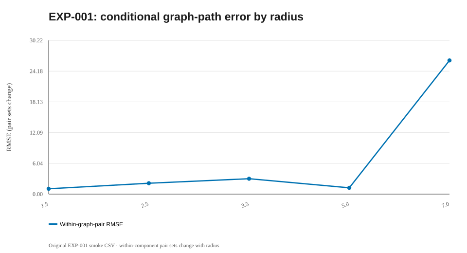

# EXP-001 — Radius graph filtration on one Swiss roll

**Research question.** Can an undirected radius-proximity graph recover the geodesic geometry of a sampled Swiss roll, and how does the radius change connectivity?

## Idea and setup

A ball of radius r centered on each observation induces edges when **center distance ≤ r** (not when two r-balls intersect at 2r). The graph is weighted by the ambient Euclidean distance between endpoints. The 240-point noiseless Swiss roll has intrinsic coordinates `(u(t),h)`, with `u(t)=[t√(1+t²)+asinh(t)]/2`. The original smoke test used radii 1.5, 2.5, 3.5, 5, 7 with seed 20261016.

## What we did

Constructed each graph, measured its connected components and edges, computed shortest paths and compared **only finite, within-graph-component pairs** against analytical intrinsic distances. No embedding coordinates were optimized in EXP-001.

## Recorded outcome

| Radius | Components | Edges | Within pairs | Graph versus intrinsic RMSE |
|---:|---:|---:|---:|---:|
| 1.5 | 88 | 231 | 776 | 1.0525 |
| 2.5 | 16 | 618 | 5,832 | 2.1399 |
| 3.5 | 3 | 1,169 | 23,473 | 3.0293 |
| 5 | 1 | 2,189 | 28,680 | 1.2396 |
| 7 | 1 | 4,431 | 28,680 | 26.2790 |

## Interpretation and failure

Connectivity improves with radius, but the shortest paths can become **shortcuts through folds** at large radius. The extreme error at r=7 is the key diagnostic. **Do not compare the small-radius RMSE directly with the large-radius RMSE as if they evaluate identical pairs**: the finite-pair set changes when components merge.

## Next question

Evaluate all original pairs against the same intrinsic reference by constructing complete 2D embeddings (EXP-002), then vary r across much wider regimes (EXP-003). A usable radius must be selected without looking at test-set ground truth.

## Mathematics: radius filtration and intrinsic geodesics

The radius graph has a vertex for each observation \(x_i\in\mathbb R^3\), and weighted edges

$$
(i,j)\in E_r \iff i\ne j\ \text{and}\ \|x_i-x_j\|_2\le r,
\qquad w_{ij}=\|x_i-x_j\|_2.
$$

Its shortest-path distance \(g_{ij}(r)\) is finite only when the points lie in the same graph component. For the unscaled Swiss roll \(x(t,h)=(t\cos t,h,t\sin t)\), an intrinsic flattening is

$$
z(t,h)=\left(F(t),h\right),\qquad
F(t)=\frac{t\sqrt{1+t^2}+\operatorname{arsinh}(t)}{2},
\quad F'(t)=\sqrt{1+t^2}.
$$

Indeed, \(\|\partial_t x\|=\sqrt{1+t^2}\), \(\|\partial_h x\|=1\), and their tangent vectors are orthogonal. The analytic target is \(d^{\mathrm{true}}_{ij}=\|z_i-z_j\|_2\). On the *radius-dependent* set \(P_r=\{(i,j):i<j,\ g_{ij}(r)<\infty\}\), the diagnostic is

$$
\mathrm{RMSE}_{P_r}(r)=
\sqrt{\frac{1}{|P_r|}\sum_{(i,j)\in P_r}
\left(g_{ij}(r)-d^{\mathrm{true}}_{ij}\right)^2}.
$$

**Interpretation:** increasing \(r\) merges components but can create shortcuts across nearby folds. Also, \(P_r\) changes with \(r\): lower RMSE at small \(r\) can simply mean that difficult pairs were excluded. Compare fixed evaluation pairs before claiming improved fidelity.

## Figure plan and reproduction status

**Full rebuilt run pending:** the runner will save PNG and SVG files and embed valid PNG links after a successful full run; do not create links to absent files. Existing historical `summary.svg` above is already visible and clearly identified as a reconstruction.

| Planned output filename | Mathematical point to illustrate | Current status |
|---|---|---|
| `radius_sweep.png` | Radius versus conditional graph-geodesic RMSE and component count; make pair-set changes explicit | Pending full rerun |

**After a new run:** confirm that image filenames and actual metric fields match the notes before interpreting the figures. [Plot directory](../../figures/001-radius_filtration/README.md) · [Result directory](../../results/001-radius_filtration/README.md).

## Linked artifacts

- [Code and source status](../../code/001-radius_filtration/README.md)
- [Numerical results and provenance](../../results/001-radius_filtration/README.md)
- [Summary diagram](../../figures/001-radius_filtration/summary.svg) — redrawn from reported values, not an original experimental screenshot
- [Figure directory and original-plot status](../../figures/001-radius_filtration/README.md)

**Research status:** Historical exploratory measurements remain below, and the rebuilt EXP-001 code is available. The full new run remains pending; the previously discussed integration ZIP will not be imported.

## Historical summary figure (not a new run)

> This SVG is a reconstructed visualization of historical rounded summaries, not a recovered 3D/2D projection. Actual figures will be embedded automatically under the latest computed run after executing the Conda pipeline.
