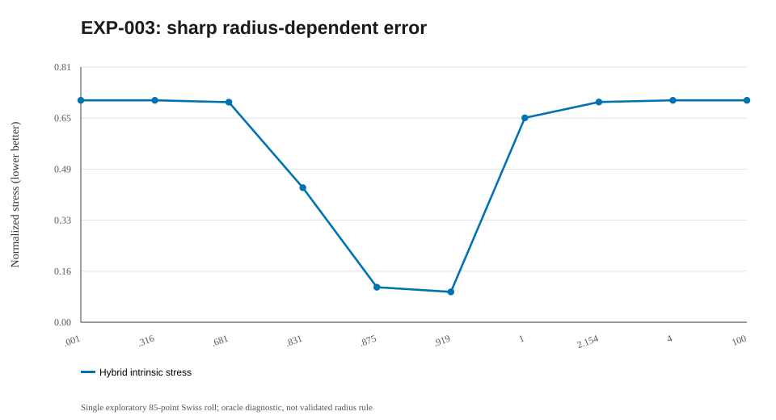
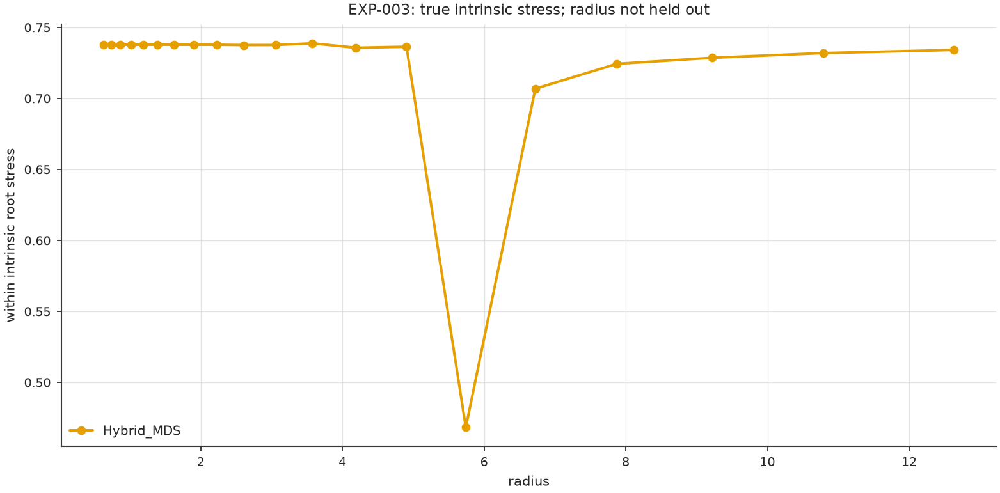

# EXP-003 — Radius sweep from isolated observations to a complete graph

**Research question.** Does the best geometric fidelity occur near graph connectivity, and what happens when the radius is extremely small or extremely large?

## Experimental design

Use a dimensionless radius `ρ=r/ℓ` where `ℓ` is the observed median tenth-nearest-neighbor distance. Explore logarithmic candidates from 0.001ℓ to 100ℓ, plus anchors around the Euclidean MST connectivity threshold and complete-graph threshold. Fix hybrid α=0.5. Cache unchanged graphs because radius edge sets are nested.

## Observed behavior

The 85-point noiseless Swiss-roll **single-seed smoke** scan contained 42 candidate radii but only 19 distinct graphs. Hybrid intrinsic stress was about 0.7075 at both extremes; its lowest *within-dataset oracle* observed stress was about 0.0969 at ρ≈0.919, with a connected graph. There was an abrupt degradation near ρ=1.0 despite no new component merge.

A separate three-seed, 120-point exploratory scan used 82 radii per seed and found best within-dataset stresses 0.0678, 0.0698 and 0.0509 at ratios near the MST connectivity threshold.

## Interpretation

A wide grid matters: tiny radii give few/no intracomponent edges and large radii create Euclidean shortcuts or complete-graph behavior. The optimum can be sharp. The minima quoted above were chosen using true geodesic distances **on the same sample**, so they are oracle diagnostics rather than deployable unsupervised radius selection.

## Failure and next question

A larger five-seed run was interrupted before writing aggregate outputs. EXP-004 therefore tests radius transfer with separate development and evaluation datasets, and later runners should checkpoint per sample.

## Mathematics: connectivity thresholds and a nonmonotone error

Use a dimensionless radius \(\rho=r/\ell\), where \(\ell>0\) is a characteristic sample distance (the *historical* experiment used the median tenth-nearest-neighbor distance). The Euclidean MST bottleneck and the complete-graph threshold are

$$
r_{\mathrm{conn}}=
\max_{e\in\operatorname{MST}(X)}|e|,
\qquad
r_{\mathrm{full}}=\max_{i<j}\|x_i-x_j\|_2.
$$

With edges included at equality, the graph is connected for \(r\ge r_{\mathrm{conn}}\) and complete for \(r\ge r_{\mathrm{full}}\). Also,

$$
r_1\le r_2\implies E_{r_1}\subseteq E_{r_2},
\qquad \beta_0(r_2)\le\beta_0(r_1).
$$

But **embedding distortion is not monotone** in \(r\): an extra edge can introduce a geometrically wrong shortest-path shortcut without changing the component count. One can use

$$
r_{\mathrm{oracle}}=
\underset{r\in\mathcal R}{\operatorname{argmin}}\;
E_{\mathrm{intrinsic}}(Y(r))
$$

only as a synthetic *diagnostic* when true intrinsic targets are available. This is **not an unsupervised radius selector**. The current reconstructed runner's radius normalization/grid differs from the historical scan; compare them as separate protocols.

## Figure plan and reproduction status

**Full rebuilt run pending:** the runner will save PNG and SVG files and embed valid PNG links after a successful full run; do not create links to absent files. Existing historical `summary.svg` above is already visible and clearly identified as a reconstruction.

| Planned output filename | Mathematical point to illustrate | Current status |
|---|---|---|
| `radius_stress.png` | Intrinsic stress across radius, with connectivity transitions or MST threshold | Pending full rerun |

**After a new run:** confirm that image filenames and actual metric fields match the notes before interpreting the figures. [Plot directory](../../figures/003-wide_radius_grid/README.md) · [Result directory](../../results/003-wide_radius_grid/README.md).

## Linked artifacts

- [Code and source status](../../code/003-wide_radius_grid/README.md)
- [Numerical results and provenance](../../results/003-wide_radius_grid/README.md)
- [Summary diagram](../../figures/003-wide_radius_grid/summary.svg) — redrawn from reported values, not an original experimental screenshot
- [Figure directory and original-plot status](../../figures/003-wide_radius_grid/README.md)

**Research status:** Historical figures/numbers are transcriptions, not outputs of the new reconstructed source. A fresh full run is pending; no integration ZIP will be imported.

## Historical summary figure (not a new run)

> This SVG is a reconstructed visualization of historical rounded summaries, not a recovered 3D/2D projection. Actual figures will be embedded automatically under the latest computed run after executing the Conda pipeline.

<!-- COMPUTED-RUN: manual-full-20261018 -->

## Computed run: manual-full-20261018

Run: **manual-full-20261018**; mode: **full**; seed: **20261018**. This run REBUILDS the research question using the current implementation; it is **not the recovered historical algorithm or an independent novelty claim**. Original arrays and metrics: [results](../../results/003-wide_radius_grid/runs/manual-full-20261018/metrics.csv); [metadata](../../results/003-wide_radius_grid/runs/manual-full-20261018/metadata.json).

| K | Method | Within intrinsic stress / diagnostic RMSE | Between ambient stress |
|---:|---|---:|---:|
| - | Hybrid_MDS | 0.737881505802001 | - |
| - | Hybrid_MDS | 0.737881505802001 | - |
| - | Hybrid_MDS | 0.7378814835873055 | - |
| - | Hybrid_MDS | 0.7378814253736177 | - |
| - | Hybrid_MDS | 0.7378813938536901 | - |
| - | Hybrid_MDS | 0.7378803543274959 | - |
| - | Hybrid_MDS | 0.7378801563930821 | - |
| - | Hybrid_MDS | 0.7378760346200468 | - |
| - | Hybrid_MDS | 0.7378786934254171 | - |
| - | Hybrid_MDS | 0.7376373968380714 | - |
| - | Hybrid_MDS | 0.7376841317799424 | - |
| - | Hybrid_MDS | 0.7388443982388806 | - |
| - | Hybrid_MDS | 0.7357573404889938 | - |
| - | Hybrid_MDS | 0.7364474871846458 | - |
| - | Hybrid_MDS | 0.4683600589743809 | - |
| - | Hybrid_MDS | 0.7069058282526648 | - |
| - | Hybrid_MDS | 0.7244185641202806 | - |
| - | Hybrid_MDS | 0.7286819962803666 | - |
| - | Hybrid_MDS | 0.7320143142752212 | - |
| - | Hybrid_MDS | 0.7342205268266175 | - |

