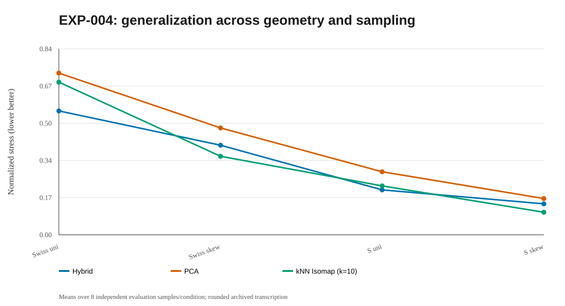

# EXP-004 — Radius transfer to new manifolds and sampling densities

**Research question.** Can a radius chosen on uniform Swiss rolls generalize to different point densities and another manifold family?

## Design

A fixed 50-point grid combines broad logarithmic radii with denser candidates near the low-error region. Select the global scale multiplier using **10 development uniformly sampled Swiss rolls only**; evaluate the chosen radius on **32 independent datasets**: 8 each for Swiss/uniform, Swiss/skewed, S-curve/uniform and S-curve/skewed. Ninety observations per dataset. The tested development-selected multiplier was ρ≈0.984 times the observed median tenth-neighbor distance. One optimization initialization and α=0.5.

## Historical reported means (within-manifold intrinsic stress; lower is better)

| Evaluation regime | Hybrid | PCA | kNN Isomap (k=10) |
|---|---:|---:|---:|
| Swiss/uniform | 0.560 | 0.731 | 0.690 |
| Swiss/skewed | 0.405 | 0.483 | **0.355** |
| S-curve/uniform | **0.203** | 0.285 | 0.221 |
| S-curve/skewed | 0.140 | 0.164 | **0.102** |

## Findings, interpretation and limitations

The selected global radius did **not** uniformly beat kNN Isomap. All eight skewed Swiss-roll graphs were still disconnected at the selected radius. Descriptive best-in-sample radii tended to be larger when sampling was skewed; those individual best radii are **post-hoc oracle diagnostics**, not fair selection scores. This motivated a possible density-aware or per-point radius—not yet validated. The comparison uses only one fixed kNN setting, not a tuned competitor.

## Failed or incomplete work

The initial long run was interrupted before final CSV writing. A newer local runner introduced per-dataset atomic checkpoints and a config hash, but those source and checkpoint files are not on GitHub main.

## Next question

Investigate whether componentwise geometry can still be preserved on **two genuinely disjoint** surfaces, with placement evaluated separately (EXP-005).

## Mathematics: choosing a radius and testing transfer

Let \(\ell(X)>0\) be a sample-dependent scale and define \(r_\rho(X)=\rho\ell(X)\). With independent *development* samples \(X_1^{\mathrm{dev}},\dots,X_m^{\mathrm{dev}}\), a scale multiplier can be chosen by

$$
\widehat\rho =
\operatorname*{argmin}_{\rho\in\mathcal R}
\frac{1}{m}\sum_{s=1}^{m}
E_{\mathrm{intrinsic}}
\left(Y_{\rho}(X_s^{\mathrm{dev}})\right).
$$

Here the analytic intrinsic distances used by the error require knowledge of the synthetic generator, so this is **oracle-assisted development tuning**, not yet a deployable unsupervised strategy. The historical experiment used a tenth-neighbor scale; the rebuilt source uses an MST-derived sample scale, so their numerical \(\rho\) values are not interchangeable.

Evaluate \(\widehat\rho\) on independent samples using the same scoring definition, for example

$$
\overline E_{c}=\frac{1}{N_c}
\sum_{s\in \mathrm{evaluation}(c)}
E_{\mathrm{intrinsic}}(Y_{\widehat\rho}(X_s)),
$$

where \(c\) indexes manifold family and density condition.

**Interpretation:** good training performance does not guarantee transfer to skewed sampling or another manifold. Report each condition and compare against *tuned* kNN Isomap as well as PCA, without choosing test-set radii afterward.

## Figure plan and reproduction status

**Full rebuilt run pending:** the runner will save PNG and SVG files and embed valid PNG links after a successful full run; do not create links to absent files. Existing historical `summary.svg` above is already visible and clearly identified as a reconstruction.

| Planned output filename | Mathematical point to illustrate | Current status |
|---|---|---|
| `density_transfer.png` | Development-selected radius transferred to uniform/skewed Swiss and S-curve samples | Pending full rerun |

**After a new run:** confirm that image filenames and actual metric fields match the notes before interpreting the figures. [Plot directory](../../figures/004-radius_transfer/README.md) · [Result directory](../../results/004-radius_transfer/README.md).

## Linked artifacts

- [Code and source status](../../code/004-radius_transfer/README.md)
- [Numerical results and provenance](../../results/004-radius_transfer/README.md)
- [Summary diagram](../../figures/004-radius_transfer/summary.svg) — redrawn from reported values, not an original experimental screenshot
- [Figure directory and original-plot status](../../figures/004-radius_transfer/README.md)

**Research status:** Historical figures/numbers are transcriptions, not outputs of the new reconstructed source. A fresh full run is pending; no integration ZIP will be imported.

## Historical summary figure (not a new run)

> This SVG is a reconstructed visualization of historical rounded summaries, not a recovered 3D/2D projection. Actual figures will be embedded automatically under the latest computed run after executing the Conda pipeline.
