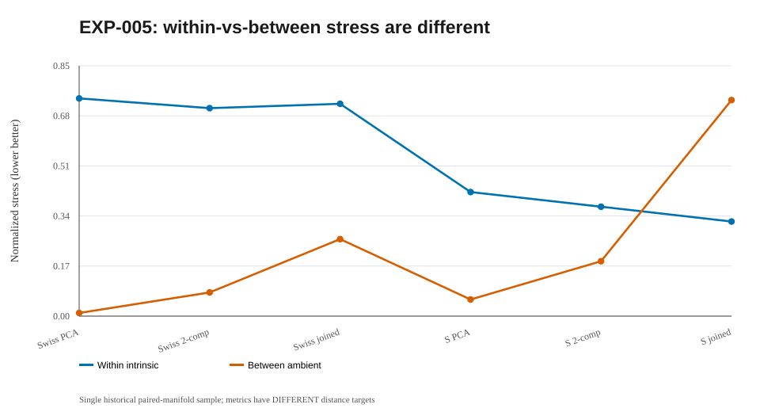

# EXP-005 — Two disconnected Swiss rolls and two disconnected S-curves

**Research question.** What happens when dimensionality reduction must embed **two genuine manifolds in one 3D dataset**, rather than a single curved sheet?

## Design

Two data families: pairs of Swiss rolls and pairs of S-curves, with 45 observations on each surface (90 per dataset). Their original x-coordinate ranges were moved apart to guarantee an interval with **exactly two graph components**, each internally connected. A 44-candidate radius grid included graph-topology transitions; α=0.5, one nonlinear optimizer start. PCA, radius hybrid MDS and kNN Isomap were compared; 3D originals and 2D projection galleries were saved in the historical ZIP archive.

## Selected historical single-seed results

| Geometry and method | Within-sheet intrinsic stress | Between-sheet ambient stress |
|---|---:|---:|
| Swiss PCA | 0.7355 | 0.0106 |
| Swiss hybrid, two components | 0.7026 | 0.0799 |
| Swiss hybrid, newly connected | 0.7173 | 0.2603 |
| S-curve PCA | 0.4192 | 0.0562 |
| S-curve hybrid, two components | 0.3696 | 0.1856 |
| S-curve hybrid, newly connected | 0.3197 | 0.7299 |

## Interpretation

**Disconnected underlying manifolds do not have finite intrinsic geodesics between them.** Thus the within-sheet stress uses known intrinsic distances, whereas the between-sheet metric uses original **ambient** Euclidean distances. On the S-curve example, the first bridge improved the within-sheet stress while heavily worsening between-sheet placement. We must never collapse the two metrics into an undefined “global intrinsic stress.”

## Open questions

The original PNG/SVG gallery cannot be reconstructed exactly from rounded scores. It awaits the archived source arrays and plotting script. One seed and untuned baselines preclude population claims. EXP-006 introduces a harder orientation intervention to stress global PCA.

## Linked artifacts

- [Code and source status](../../code/005-paired_manifolds/README.md)
- [Numerical results and provenance](../../results/005-paired_manifolds/README.md)
- [Summary diagram](../../figures/005-paired_manifolds/summary.svg) — redrawn from reported values, not an original experimental screenshot
- [Figure directory and original-plot status](../../figures/005-paired_manifolds/README.md)

**Research status:** Exploratory and historical. Full EXP-002–EXP-008 source, 3D projections, raw arrays and original figure artifacts remain outside GitHub until the cumulative ZIP is imported. Do not claim reproduced results from current main.

## Historical summary figure (not a new run)

> This SVG is a reconstructed visualization of historical rounded summaries, not a recovered 3D/2D projection. Actual figures will be embedded automatically under the latest computed run after executing the Conda pipeline.

