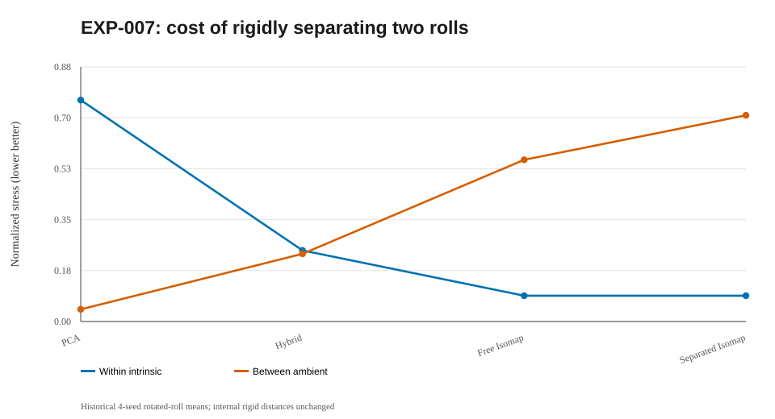

# EXP-007 — Unfold graph components independently, then rigidly separate

**Research question.** Why did disconnected Swiss-roll projections cross, and can we guarantee non-overlap without re-distorting each separately unfolded roll?

## Algorithm

1. Build a radius graph with exactly two connected components.
2. Compute shortest paths **inside each component**, then classical MDS (Isomap) independently.
3. Solve for each component's planar rotation and translation to approximate **original ambient cross-component Euclidean distances**.
4. Compare free alignment with a **positive x-coordinate hull gap**; allow both components to rotate before imposing the gap.

Rigid alignment leaves distances of the **computed independent embeddings** unchanged, even though they may not exactly equal the true intrinsic geodesics. The strip constraint makes both projected convex hulls disjoint.

## Four-seed means on rotated 360-point paired Swiss rolls

| Method | Within-sheet intrinsic stress | Between-sheet ambient stress |
|---|---:|---:|
| PCA | 0.7646 | **0.0420** |
| Global hybrid MDS | 0.2455 | 0.2338 |
| Componentwise Isomap + free alignment | **0.0891** | 0.5584 |
| Componentwise Isomap + positive separation | **0.0891** | 0.7120 |

## Failure and correction

The first attempt kept component 1 horizontally fixed and forced large displacement along x, with very high between stress (approximately 1.06 on one rotated seed). Allowing **both** components to rotate reduced that particular error substantially. This records a real abandoned design, not a result to hide.

## Interpretation and limitations

Non-overlap was guaranteed, and internal computed distances were preserved to floating-point precision. But the guarantee can increase relative-placement distortion. These are tradeoffs, not dominance claims. The method was originally implemented for **exactly two** components and used a label-informed diagnostic radius. EXP-008 generalizes to K components.

## Mathematics: exact internal invariance and separation guarantee

After independent Isomap, each component has coordinates \(Z_k\in\mathbb R^{n_k\times 2}\). Align components using rigid poses,

$$
Y_k=Z_kQ_k+\mathbf 1\,t_k^\top,
\qquad Q_k^\top Q_k=I_2.
$$

Then for all \(i,j\in C_k\),

$$
\|y_i-y_j\|_2=\|(z_i-z_j)Q_k\|_2
=\|z_i-z_j\|_2.
$$

This **exactly preserves computed Isomap embedding distances**; it does not repair errors between those distances and the true intrinsic geodesics. A sufficient hard separation constraint along the horizontal axis is

$$
\max_{i\in C_k}(y_i)_1+m
\leq\min_{j\in C_{k+1}}(y_j)_1,\qquad m>0.
$$

Every pair of projected component convex hulls is then disjoint, with Euclidean clearance at least \(m\). This is a sufficient *strip* condition, stricter than general convex-hull nonintersection. A natural placement objective is \(E_{\mathrm{between}}(Y)\) from [EXP-005](../005-paired_manifolds/README.md).

**Interpretation:** free and constrained *locally optimized* solutions can differ because the objective is nonconvex. Rigid within-distances should remain unchanged to numerical precision; forcing a gap can worsen between-stress.

## Figure plan and reproduction status

**Full rebuilt run pending:** the runner will save PNG and SVG files and embed valid PNG links after a successful full run; do not create links to absent files. Existing historical `summary.svg` above is already visible and clearly identified as a reconstruction.

| Planned output filename | Mathematical point to illustrate | Current status |
|---|---|---|
| `rotated_pair.png` | Free versus separated Isomap and convex-hull/strip clearance | Pending full rerun |

**After a new run:** confirm that image filenames and actual metric fields match the notes before interpreting the figures. [Plot directory](../../figures/007-component_alignment/README.md) · [Result directory](../../results/007-component_alignment/README.md).

## Linked artifacts

- [Code and source status](../../code/007-component_alignment/README.md)
- [Numerical results and provenance](../../results/007-component_alignment/README.md)
- [Summary diagram](../../figures/007-component_alignment/summary.svg) — redrawn from reported values, not an original experimental screenshot
- [Figure directory and original-plot status](../../figures/007-component_alignment/README.md)

**Research status:** Historical figures/numbers are transcriptions, not outputs of the new reconstructed source. A fresh full run is pending; no integration ZIP will be imported.

## Historical summary figure (not a new run)

> This SVG is a reconstructed visualization of historical rounded summaries, not a recovered 3D/2D projection. Actual figures will be embedded automatically under the latest computed run after executing the Conda pipeline.
