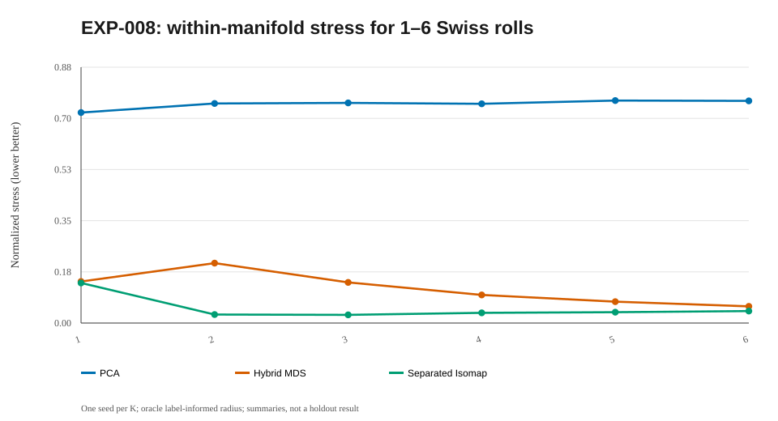

# EXP-008 — From one to six separately embedded Swiss rolls

**Research question.** Can rigid componentwise Isomap scale from **1 through 6** genuinely disjoint rotated Swiss rolls while guaranteeing geometric non-overlap in 2D?

## Design

For each K=1,…,6, sample **180 points per roll** (180–1080 observations), seed 20261017, with different 3D orientations and original x-bounding-box gaps. Select the graph radius slightly larger than the **maximum within-true-roll Euclidean MST edge**. This uses known synthetic labels and is therefore a diagnostic radius, not an unsupervised model-selection procedure. Fit global PCA, hybrid MDS (α=0.5), free componentwise Isomap alignment and separation-constrained alignment. The latter imposes ordered positive 2D strips for all K; full cross distances were evaluated afterward, though optimizer placement used 16 spread anchors per component.

## Original one-seed reported measurements

| Rolls K | Points | PCA within | Hybrid within | Component Isomap within (free = separated) | Free cross ambient | Separated cross ambient |
|---:|---:|---:|---:|---:|---:|---:|
| 1 | 180 | 0.720 | 0.142 | 0.137 | — | — |
| 2 | 360 | 0.751 | 0.205 | 0.029 | 0.478 | 0.574 |
| 3 | 540 | 0.753 | 0.139 | 0.028 | 0.390 | 0.390 |
| 4 | 720 | 0.750 | 0.096 | 0.035 | 0.315 | 0.303 |
| 5 | 900 | 0.761 | 0.073 | 0.037 | 0.265 | 0.252 |
| 6 | 1,080 | 0.760 | 0.057 | 0.041 | 0.205 | 0.208 |

## Major negative result

At **90 points per roll**, adding the third roll increased the global internal connectivity radius enough to introduce shortcuts and drove intracomponent error up sharply (approximately 0.64 versus 0.14 before). Increasing density to 180 reduced the observed error for this seed but gives **no general guarantee**.

## Algorithmic findings

All K components remained geometrically disjoint in the separated layout, and rigid alignment perturbed computed within-embedding pair distances only at rounding error (~4.3×10⁻¹⁴). Under constrained local optimization, some K=4–5 between stresses were lower than free-fit stresses—this is possible for **different nonconvex local solutions** and does not violate monotonicity of the *global* constrained optimum.

## Interpretation for the paper

A successful visualization of six separated rolls is **not the main contribution**. What matters is quantifying and controlling separation–distortion, verifying an unsupervised radius rule, and comparing a fair Pareto frontier with prior multi-manifold methods. True cross-manifold intrinsic geodesics are not finite. New 3D and 2D PNG/SVG galleries remain pending generation by the reconstructed code; the old ZIP will not be imported.

## Mathematics: \(K\)-component alignment and its tradeoff

For \(K\) graph components embedded independently, the shared target is

$$
\begin{aligned}
V(\mu)=\inf_{\{Q_k,t_k\}_{k=1}^K}\quad
&E_{\mathrm{between}}(Y)\\
\text{subject to}\quad
&Y_k=Z_kQ_k+\mathbf 1t_k^\top,\quad Q_k^\top Q_k=I_2,\\
&\min_{k<\ell}
\operatorname{dist}\bigl(\operatorname{conv}Y_k,
\operatorname{conv}Y_\ell\bigr)\ge\mu s,
\end{aligned}
$$

where \(s>0\) is a fixed reference length and \(\mu>0\) is dimensionless. When \(K=1\), cross-component stress and minimum cross-component clearance are **not defined**; report them as N/A.

For \(\mu_2\ge\mu_1\), the feasible-set inclusion

$$
\mathcal F(\mu_2)\subseteq\mathcal F(\mu_1)
\quad\Longrightarrow\quad V(\mu_2)\ge V(\mu_1)
$$

holds for the **global** optimum, with \(V=+\infty\) if infeasible. A heuristic using fixed coordinate strips and local optimization does not necessarily attain \(V\), and its measured values need not be monotone.

**Interpretation:** the paper's central result is the measured separation–distortion *frontier*, not a gallery of six non-overlapping rolls. Vary \(\mu\), solver starts, \(K\), density, and true input separation; distinguish oracle radius diagnostics from genuinely unsupervised selection.

## Figure plan and reproduction status

**Full rebuilt run pending:** the runner will save PNG and SVG files and embed valid PNG links after a successful full run; do not create links to absent files. Existing historical `summary.svg` above is already visible and clearly identified as a reconstruction.

| Planned output filename | Mathematical point to illustrate | Current status |
|---|---|---|
| `rolls_01.png` | One Swiss roll (no intercomponent error) | Pending full rerun |
| `rolls_03.png` | Three disconnected rolls | Pending full rerun |
| `rolls_06.png` | Six disconnected rolls | Pending full rerun |
| `within_stress_vs_count.png` | Intrinsic stress versus number of rolls | Pending full rerun |

**After a new run:** confirm that image filenames and actual metric fields match the notes before interpreting the figures. [Plot directory](../../figures/008-multiple_swiss_rolls/README.md) · [Result directory](../../results/008-multiple_swiss_rolls/README.md).

## Linked artifacts

- [Code and source status](../../code/008-multiple_swiss_rolls/README.md)
- [Numerical results and provenance](../../results/008-multiple_swiss_rolls/README.md)
- [Summary diagram](../../figures/008-multiple_swiss_rolls/summary.svg) — redrawn from reported values, not an original experimental screenshot
- [Figure directory and original-plot status](../../figures/008-multiple_swiss_rolls/README.md)

**Research status:** Historical figures/numbers are transcriptions, not outputs of the new reconstructed source. A fresh full run is pending; no integration ZIP will be imported.

## Historical summary figure (not a new run)

> This SVG is a reconstructed visualization of historical rounded summaries, not a recovered 3D/2D projection. Actual figures will be embedded automatically under the latest computed run after executing the Conda pipeline.
