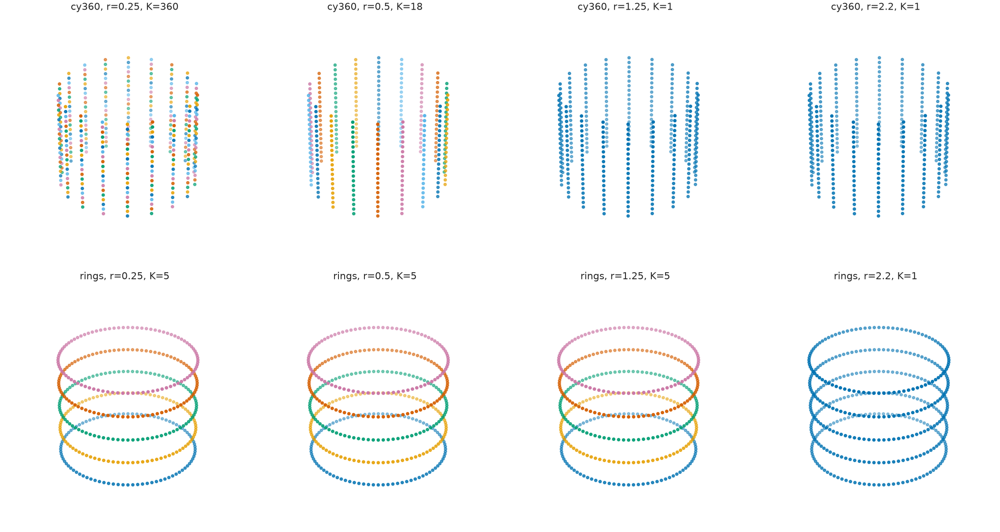

# EXP-010 — Cylinder versus five disconnected circular rings

**New status (2026-10-19):** The full Windows experiment was executed and pushed. The earlier pilot remains labeled below; the new measurements and genuine PNG figures are documented in the computed-run section.

## Research question

A cylinder is one connected surface with one essential loop; five separate circles are five connected components with five loops. How do graph radius and sample density affect their **sampled** graph connectivity and fixed-scale VR topology? Synthetic configurations: cylinders sampled on grids of 54, 144, 360 and 720 points; five rings with 90 points per ring. This is deterministic, not Poisson sampling.

## Mathematics: H0 graph components and H1 VR holes

Edges occur iff \(\|x_i-x_j\|_2\le r\). If \(T\) is the Euclidean minimum spanning tree, the number of components is

$$
\beta_0(r)=n-\#\{e\in T:w(e)\le r\}.
$$

For the Vietoris–Rips complex of vertices, edges and filled triangles, using the boundary map over \(\mathbb F_2\),

$$
\beta_1(r)=|E_r|-n+\beta_0(r)-\operatorname{rank}_{\mathbb F_2}(\partial_2).
$$

The runner calculates **fixed-scale H1 counts**, not persistence birth/death pairs. It also produces a 2D componentwise Isomap illustration at radius 1.25; this does not guarantee preservation of the input-space Rips topology.

## Earlier exploratory pilot — not the forthcoming user run

| Sample | Points | Components at r=0.5 | Components at r=1.25 |
|---|---:|---:|---:|
| Cylinder sparse | 54 | 54 | 54 |
| Cylinder | 144 | 144 | 12 |
| Cylinder | 360 | 18 | 1 |
| Cylinder | 720 | 24 | 1 |
| Five separated circles | 450 | 5 | 5 |

The previous grid pilot also observed \(\beta_1(1.15)=343\) for the 360-point cylinder and \(\beta_1(1.25)=1\); the first number represents temporary grid cycles, not 343 holes in the underlying cylinder.

## Figure plan and reproduction status

| Native PNG + SVG figure stem | What it will show | Status |
|---|---|---|
| \`geometry\` | 3D cylinder versus separate circles | Completed: 20261019T061001Z-full |
| \`radius_topology\` | Graph H0 and fixed-scale VR H1 | Completed: 20261019T061001Z-full |
| \`radius_snapshots\` | Component fragmentation/merging | Completed: 20261019T061001Z-full |
| \`projections\` | Original 3D, PCA and componentwise Isomap | Completed: 20261019T061001Z-full |

Results will include CSV counts, raw observations NPZ, JSON metadata and SHA256 manifest under \`../../results/010-radius_density_and_rings/runs/<RUN_ID>/\`. The user has pushed the full run; the assistant's new Computed run section below uses those exact files and replaces the provisional findings with findings, uncertainties, negative cases and embedded generated images. Do not silently combine previous-pilot values with new runs.

## Computed run: 20261019T061001Z-full

This section uses **the actual Windows run**, not the prior exploratory pilot. [Summary CSV](../../results/010-radius_density_and_rings/runs/20261019T061001Z-full/summary.csv), [fixed-scale Betti CSV](../../results/010-radius_density_and_rings/runs/20261019T061001Z-full/fixed_scale_betti.csv), [metadata](../../results/010-radius_density_and_rings/runs/20261019T061001Z-full/metadata.json) and actual PNG/SVG figures are on GitHub.

### Connected-component recovery

| Synthetic cloud | Points | Largest full-cloud MST edge | beta0 at r=0.50 | beta0 at r=1.25 |
|---|---:|---:|---:|---:|
| Cylinder 9 by 6 | 54 | 2.1205 | 54 | 54 |
| Cylinder 12 by 12 | 144 | 1.6047 | 144 | 12 |
| Cylinder 18 by 20 | 360 | 1.0766 | 18 | **1** |
| Cylinder 24 by 30 | 720 | 0.8093 | 24 | **1** |
| Five distinct circles | 450 | 2.0000 | **5** | **5** |

The full-cloud MST threshold of 2.0000 for the rings includes **between-ring edges** and must not be presented as the per-ring connectivity threshold. On the cylinder, denser deterministic grids connect at a smaller radius. On the rings, five disconnected source supports remain five graph components over the chosen radius.

### Homology at selected radii

For the 360-point cylinder, the measured pairs \((\beta_0,\beta_1)\) are (18,0) at radius 0.50, (1,343) at 1.15, and (1,1) at both 1.25 and 1.50. Five circles have (5,5) at each tested radius 0.25, 0.50, 1.25 and 1.80. The numerous finite-grid cycles at 1.15 do **not** imply hundreds of holes in the continuous cylinder. The runner computes fixed-scale VR homology (including triangles), **not full persistence intervals**.

### Original figures from this computed run

The samples clarify that stacked slices of a connected cylinder are not five disconnected circles.

Graph connectivity and VR loops respond differently to a changing radius; a sample grid can have spurious short-scale cycles.

Changing the graph scale fragments or connects a *finite graph*; it does not change the topology of the underlying ideal support.

Isomap may produce a visually useful projection without preserving the source ambient VR filtration.

**Limitations:** noiseless regular grids, selected radii rather than a full H1 barcode, no statistical repetition, and no guarantee that 2D Isomap preserves manifold topology. The next experiments should use random sampling, topology-aware diagnostics, and independently selected neighborhood scales.
