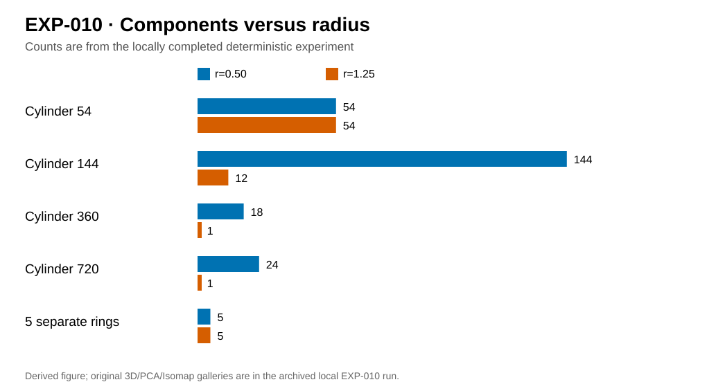

# EXP-010 — Cylinder versus five disconnected circular rings

**Stage A complete:** [native Python runner](../../code/010-radius_density_and_rings/run.py) committed to GitHub. **Stage B pending:** the user's Windows experiment will generate new numerical results and figures; **Stage C:** the assistant will interpret the *actual pushed results* here and update Marp checkpoint 012.

## Research question

A cylinder is one connected surface with one essential loop; five separate circles are five connected components with five loops. How do graph radius and sample density affect their **sampled** graph connectivity and fixed-scale VR topology? Synthetic configurations: cylinders sampled on grids of 54, 144, 360 and 720 points; five rings with 90 points per ring. This is deterministic, not Poisson sampling.

## Mathematics: H0 graph components and H1 VR holes

Edges occur iff \(\|x_i-x_j\|_2\le r\). If \(T\) is the Euclidean minimum spanning tree, the number of components is

$$
\beta_0(r)=n-\#\{e\in T:w(e)\le r\}.
$$

For the Vietoris–Rips complex of vertices, edges and filled triangles, using the boundary map over \(\mathbb F_2\),

$$
\beta_1(r)=|E_r|-n+\beta_0(r)-\operatorname{rank}_{\mathbb F_2}(\partial_2).
$$

The runner calculates **fixed-scale H1 counts**, not persistence birth/death pairs. It also produces a 2D componentwise Isomap illustration at radius 1.25; this does not guarantee preservation of the input-space Rips topology.

## Earlier exploratory pilot — not the forthcoming user run

| Sample | Points | Components at r=0.5 | Components at r=1.25 |
|---|---:|---:|---:|
| Cylinder sparse | 54 | 54 | 54 |
| Cylinder | 144 | 144 | 12 |
| Cylinder | 360 | 18 | 1 |
| Cylinder | 720 | 24 | 1 |
| Five separated circles | 450 | 5 | 5 |

The previous grid pilot also observed \(\beta_1(1.15)=343\) for the 360-point cylinder and \(\beta_1(1.25)=1\); the first number represents temporary grid cycles, not 343 holes in the underlying cylinder.

## Figure plan and reproduction status

| Native PNG + SVG figure stem | What it will show | Status |
|---|---|---|
| \`geometry\` | 3D cylinder versus separate circles | Awaiting user run |
| \`radius_topology\` | Graph H0 and fixed-scale VR H1 | Awaiting user run |
| \`radius_snapshots\` | Component fragmentation/merging | Awaiting user run |
| \`projections\` | Original 3D, PCA and componentwise Isomap | Awaiting user run |

Results will include CSV counts, raw observations NPZ, JSON metadata and SHA256 manifest under \`../../results/010-radius_density_and_rings/runs/<RUN_ID>/\`. After the user pushes the new run, the assistant must read those exact files and replace this pre-run checkpoint with findings, uncertainties, negative cases and embedded generated images. Do not silently combine previous-pilot values with new runs.