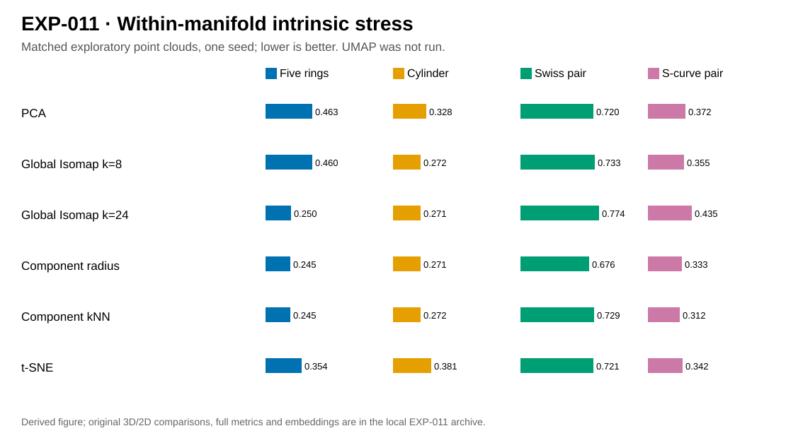

# EXP-011 — Componentwise kNN Isomap versus other dimensionality-reduction methods

**Stage A complete:** [native Python runner](../../code/011-isomap_baselines/run.py) committed to GitHub. **Stage B pending:** the user runs it locally; **Stage C:** the assistant interprets the new pushed CSV/NPZ/PNG/SVG and updates this note and Marp checkpoint 012.

## Research question and methods

Compare **componentwise kNN Isomap** and componentwise radius Isomap with global Isomap \(k=8,24\), global radius Isomap, PCA, t-SNE and actual **UMAP**. Five synthetic datasets are used: five rings, cylinder, two rotated Swiss rolls, two S-curves and torus. Global Isomap can automatically insert links across disconnected kNN components; this is recorded. Global radius Isomap reports failure rather than adding undocumented bridges. The torus analytic intrinsic geodesics are not computed. Some scenarios supply the true \(K\) to MST cutting (explicit oracle diagnostic).

## Mathematics: distortion and spatial separation

Before scoring, rescale each \(Y\) uniformly by the observed ambient within-group RMS ratio,

$$
s=\sqrt{\frac{\sum_k\sum_{i\ne j\in C_k}\|x_i-x_j\|^2}
{\sum_k\sum_{i\ne j\in C_k}\|y_i-y_j\|^2}},\quad \widetilde Y=sY.
$$

For the known synthetic within-manifold geodesics \(g_{ij}\), use

$$
S_{\rm within}=\sqrt{\frac{\sum_k\sum_{i<j\in C_k}
(\|\tilde y_i-\tilde y_j\|-g_{ij})^2}
{\sum_k\sum_{i<j\in C_k}g_{ij}^2}}.
$$

Across disconnected manifolds, **intrinsic geodesic distance is not finite**; we instead measure normalized cross-component *ambient* stress, centroid-distance stress, and the number of intersecting 2D convex-hull pairs. Neighborhood trustworthiness at \(k=8\) and runtime are reported separately: t-SNE and UMAP chiefly target local neighborhoods, not global metric fidelity. Generating labels are used only for synthetic diagnostic evaluation.

## Earlier exploratory pilot — not the forthcoming user run

| Method | Five rings | Cylinder | Swiss pair | S-curve pair |
|---|---:|---:|---:|---:|
| PCA | 0.463 | 0.328 | 0.720 | 0.372 |
| Global Isomap k=8 | 0.460 | 0.272 | 0.733 | 0.355 |
| Global Isomap k=24 | 0.250 | 0.271 | 0.774 | 0.435 |
| Componentwise radius Isomap | **0.245** | **0.271** | **0.676** | 0.333 |
| Componentwise kNN Isomap | **0.245** | 0.272 | 0.729 | **0.312** |
| t-SNE | 0.354 | 0.381 | 0.721 | 0.342 |
| UMAP | Not run | Not run | Not run | Not run |

The old pilot's ring projection showed non-overlapping componentwise Isomap hulls but severe centroid displacement. This is exploratory evidence, **not** a confirmed comparative advantage. The new runner's implementation and metrics may differ; do not merge results without checking definitions.

## Figure plan and reproduction status

| PNG/SVG output stem | Interpretation | Status |
|---|---|---|
| \`rings_embeddings\`, \`cylinder_embeddings\` | Rings/cylinder across methods | User run pending |
| \`swiss_pair_embeddings\`, \`s_curve_pair_embeddings\` | Separately rotated surfaces | User run pending |
| \`torus_embeddings\` | One torus across methods | User run pending |
| \`intrinsic_stress\` | Within-manifold geometry | User run pending |
| \`centroid_stress\` | Intercomponent placement | User run pending |
| \`trustworthiness_8\` | Local neighborhood fidelity | User run pending |

The full run will save \`metrics.csv\`, scenario input and embedding NPZ, metadata and SHA256 hashes under matching immutable results/figures folders. UMAP must be installed and explicitly required in the user's command. The assistant writes the run-specific scientific discussion **only after inspecting those pushed artifacts**.