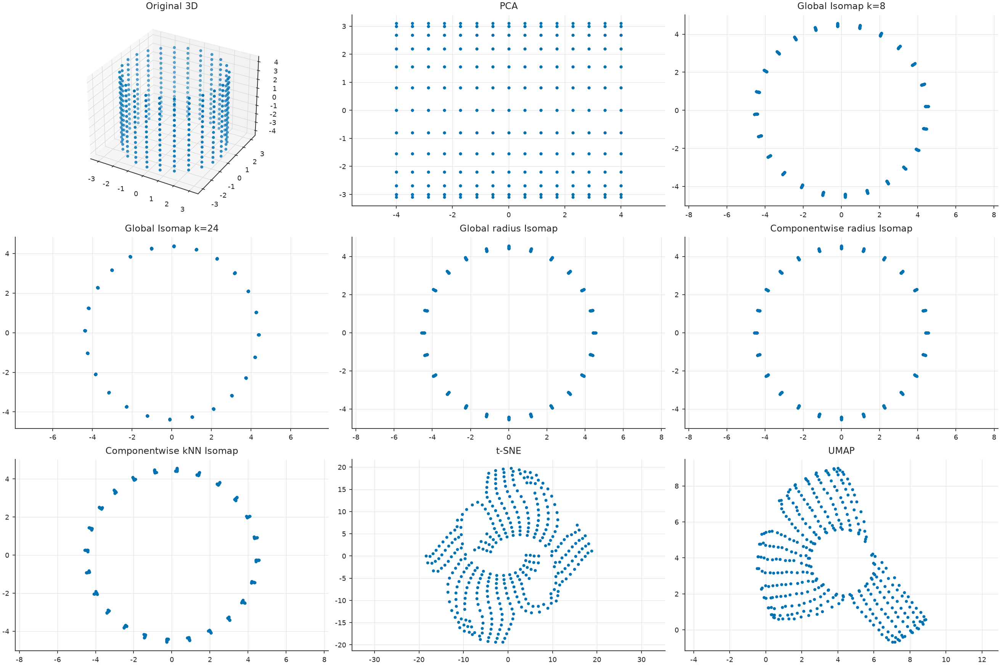
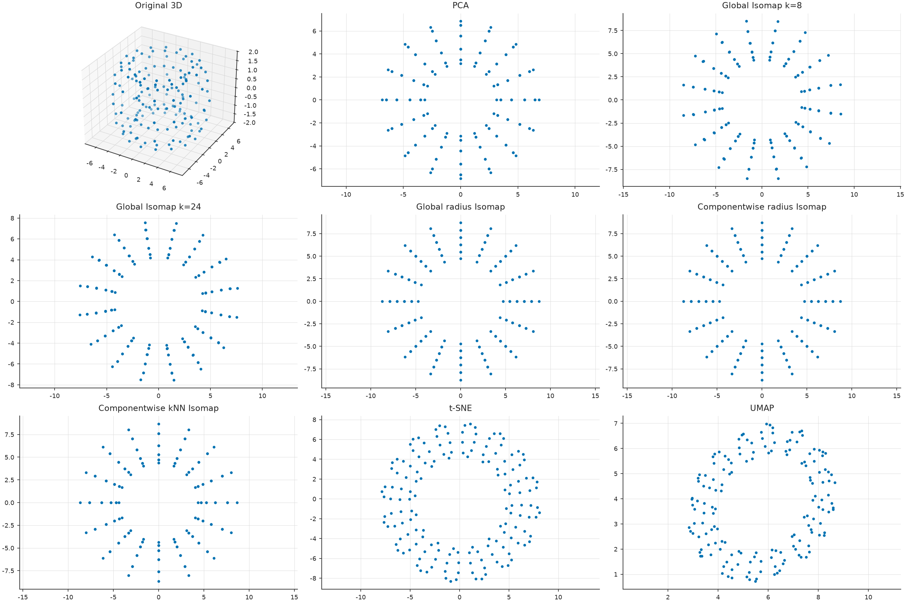

# EXP-011 — Componentwise kNN Isomap versus other dimensionality-reduction methods

**New status (2026-10-19):** the full Windows benchmark has been executed and pushed to GitHub, with genuine UMAP included. The earlier pilot remains separated below; this note now includes actual computed results and PNG figures.

## Research question and methods

Compare **componentwise kNN Isomap** and componentwise radius Isomap with global Isomap \(k=8,24\), global radius Isomap, PCA, t-SNE and actual **UMAP**. Five synthetic datasets are used: five rings, cylinder, two rotated Swiss rolls, two S-curves and torus. Global Isomap can automatically insert links across disconnected kNN components; this is recorded. Global radius Isomap reports failure rather than adding undocumented bridges. The torus analytic intrinsic geodesics are not computed. Some scenarios supply the true \(K\) to MST cutting (explicit oracle diagnostic).

## Mathematics: distortion and spatial separation

Before scoring, rescale each \(Y\) uniformly by the observed ambient within-group RMS ratio,

$$
s=\sqrt{\frac{\sum_k\sum_{i\ne j\in C_k}\|x_i-x_j\|^2}
{\sum_k\sum_{i\ne j\in C_k}\|y_i-y_j\|^2}},\quad \widetilde Y=sY.
$$

For the known synthetic within-manifold geodesics \(g_{ij}\), use

$$
S_{\rm within}=\sqrt{\frac{\sum_k\sum_{i<j\in C_k}
(\|\tilde y_i-\tilde y_j\|-g_{ij})^2}
{\sum_k\sum_{i<j\in C_k}g_{ij}^2}}.
$$

Across disconnected manifolds, **intrinsic geodesic distance is not finite**; we instead measure normalized cross-component *ambient* stress, centroid-distance stress, and the number of intersecting 2D convex-hull pairs. Neighborhood trustworthiness at \(k=8\) and runtime are reported separately: t-SNE and UMAP chiefly target local neighborhoods, not global metric fidelity. Generating labels are used only for synthetic diagnostic evaluation.

## Earlier exploratory pilot — not the forthcoming user run

| Method | Five rings | Cylinder | Swiss pair | S-curve pair |
|---|---:|---:|---:|---:|
| PCA | 0.463 | 0.328 | 0.720 | 0.372 |
| Global Isomap k=8 | 0.460 | 0.272 | 0.733 | 0.355 |
| Global Isomap k=24 | 0.250 | 0.271 | 0.774 | 0.435 |
| Componentwise radius Isomap | **0.245** | **0.271** | **0.676** | 0.333 |
| Componentwise kNN Isomap | **0.245** | 0.272 | 0.729 | **0.312** |
| t-SNE | 0.354 | 0.381 | 0.721 | 0.342 |
| UMAP | Not run | Not run | Not run | Not run |

The old pilot's ring projection showed non-overlapping componentwise Isomap hulls but severe centroid displacement. This is exploratory evidence, **not** a confirmed comparative advantage. The new runner's implementation and metrics may differ; do not merge results without checking definitions.

## Figure plan and reproduction status

| PNG/SVG output stem | Interpretation | Status |
|---|---|---|
| \`rings_embeddings\`, \`cylinder_embeddings\` | Rings/cylinder across methods | User run pending |
| \`swiss_pair_embeddings\`, \`s_curve_pair_embeddings\` | Separately rotated surfaces | User run pending |
| \`torus_embeddings\` | One torus across methods | User run pending |
| \`intrinsic_stress\` | Within-manifold geometry | User run pending |
| \`centroid_stress\` | Intercomponent placement | User run pending |
| \`trustworthiness_8\` | Local neighborhood fidelity | User run pending |

The full run will save \`metrics.csv\`, scenario input and embedding NPZ, metadata and SHA256 hashes under matching immutable results/figures folders. UMAP must be installed and explicitly required in the user's command. The assistant writes the run-specific scientific discussion **only after inspecting those pushed artifacts**.

## Computed run: 20261019T061001Z-full — genuine UMAP included

The **actual full Windows run** used seed 20261018 and evaluated eight methods on five datasets. The [saved metadata](../../results/011-isomap_baselines/runs/20261019T061001Z-full/metadata.json) confirms UMAP was installed; [metrics.csv](../../results/011-isomap_baselines/runs/20261019T061001Z-full/metrics.csv) contains the complete method-by-dataset scores, failures, runtime, graph-reconnection flags and overlap diagnostics.

### Within-manifold intrinsic stress

The following values come from the new run, not the older pilot table above. Smaller is better.

| Method | Five rings | Cylinder | Swiss pair | S-curve pair |
|---|---:|---:|---:|---:|
| PCA | 0.463 | 0.328 | **0.720** | 0.372 |
| Global Isomap k=8 | 0.439 | 0.272 | 0.733 | 0.355 |
| Global Isomap k=24 | 0.250 | **0.271** | 0.774 | 0.435 |
| Componentwise radius Isomap | **0.245** | 0.271 | **0.676** | 0.333 |
| Componentwise kNN Isomap | **0.245** | 0.272 | 0.729 | **0.312** |
| t-SNE | 0.323 | 0.337 | 0.721 | 0.344 |
| **UMAP (executed)** | 0.253 | 0.349 | 0.717 | 0.353 |

The torus has **no assigned intrinsic surface-geodesic stress** because its analytic surface distances were not computed; the other metrics and its gallery are recorded. These scores apply the runner's common, *ambient within-component* RMS rescaling before evaluation. They should not be merged with a differently scaled or differently implemented pilot.

### Why one metric is not enough — five rings

| Method | Intrinsic stress ↓ | Trustworthiness at 8 neighbors ↑ | Centroid stress ↓ | Overlapping hull pairs ↓ |
|---|---:|---:|---:|---:|
| PCA | 0.463 | 0.848 | **0.414** | 0 |
| Global Isomap k=24 | 0.250 | 0.809 | 0.996 | **10** |
| Componentwise kNN Isomap | **0.245** | 0.944 | 2.311 | **0** |
| t-SNE | 0.323 | 1.000 | 2.178 | 1 |
| UMAP | 0.253 | 1.000 | 6.263 | 0 |

There are ten unordered pairs among five component hulls. The global Isomap k=24 projection overlaps **all ten** in this dataset. Componentwise kNN Isomap gives a separated set of rings and lower within stress here, but its **centroid stress of 2.311** is substantially worse than PCA's **0.414**. UMAP retains local neighborhoods especially well, but its centroid stress is larger still. Intrinsic unfolding and intercomponent placement are separate objectives.

**Important negative finding:** On the Swiss-roll pair, componentwise kNN Isomap intrinsic stress (0.729) is not better than PCA (0.720). On the S-curves, componentwise kNN Isomap reaches 0.312, lower than the listed global Isomap alternatives. **No general dominance has been established.**

### What the current code actually computes

The class named **componentwise kNN Isomap** does not detect components by a global kNN graph in this run. The implementation first uses either a **radius graph** (rings/cylinder/torus) or an **MST cut with the true number K supplied** (Swiss/S-curve pairs), then **rebuilds a symmetrized 10-neighbor graph inside each component**, uses shortest paths and 2D MDS, and arranges components with rigid separated strips. The source code and metadata are the authoritative definition, not a loose algorithm name. Thus a future EXP-013 should vary k for *detection* and k for *embedding* separately. Global Isomap may add bridges to reconnect disjoint kNN graphs; the CSV records warnings and bridge diagnostics, while disconnected global radius Isomap is marked failed/skipped.

### Actual visual evidence, saved on GitHub

### Interpretation, caveats and new research

Independent Isomap plus strip placement can preserve the distances of its **already-computed 2D embedding** under rigid motion. The method does not exactly recover the original manifold geodesics, and strip placement can badly distort ambient intercomponent positions. This was one seed with fixed hyperparameters and some oracle K diagnostics; direct prior-art multi-manifold methods were not implemented here. To study an actually independent kNN partition, run a grid over k for detection and unfolding, evaluate under varied random seeds and densities, and optimize constrained centroid/landmark placement rather than relying only on a strip heuristic.

A class-style mathematical derivation with these actual figures is in the [componentwise kNN-Isomap Marp lecture](../012-presentation_checkpoint/componentwise_knn_isomap_lecture.md).
