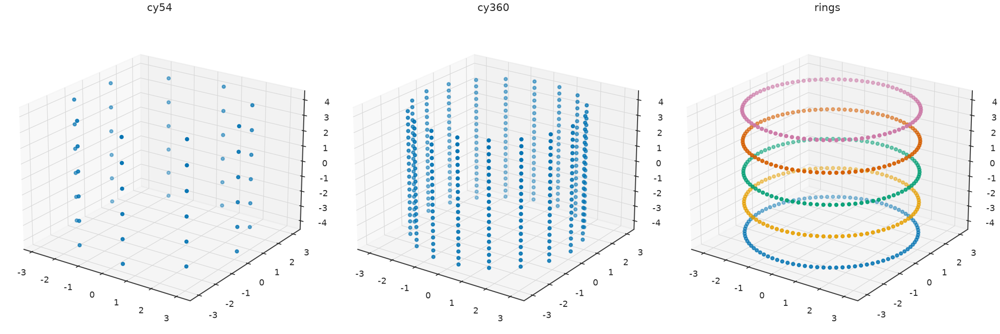
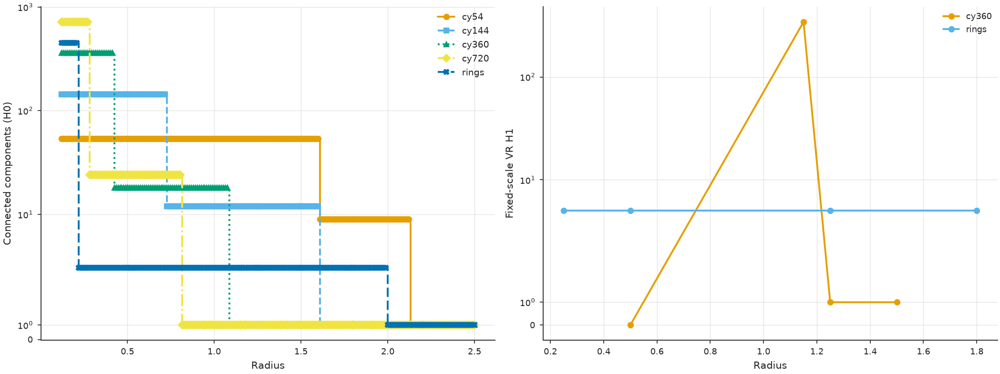
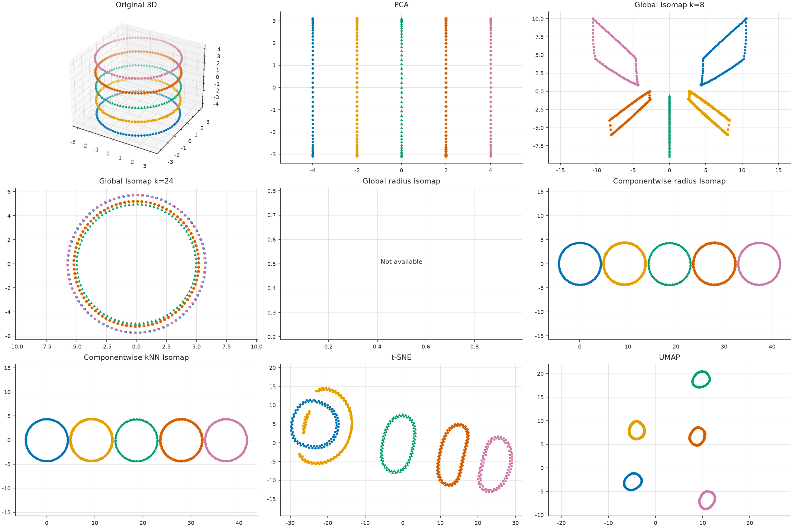
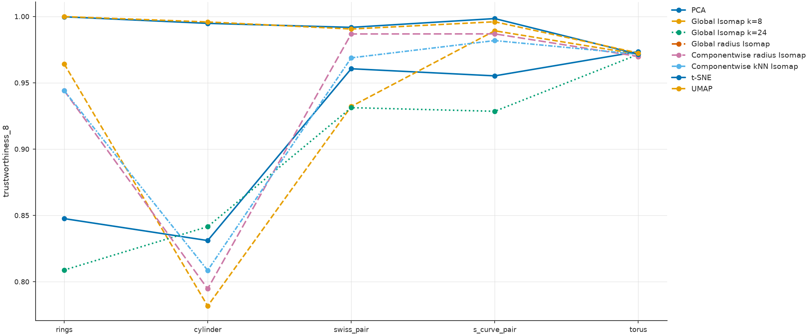
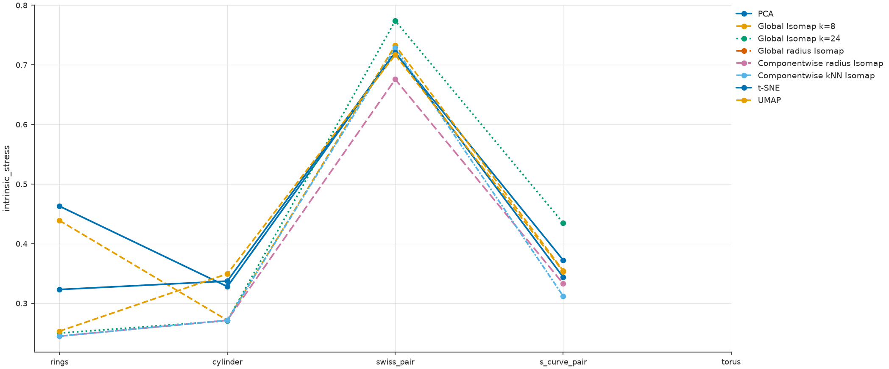
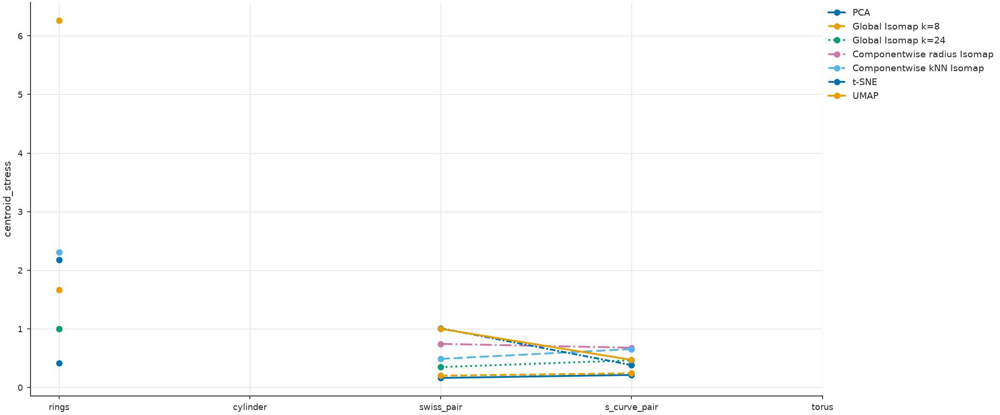
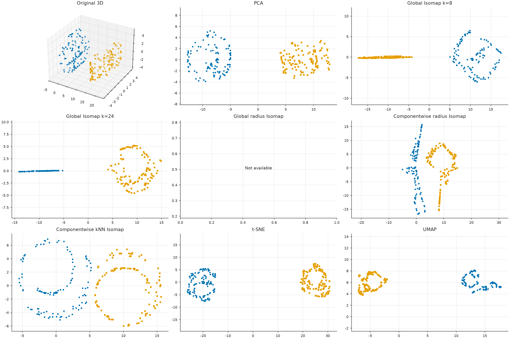
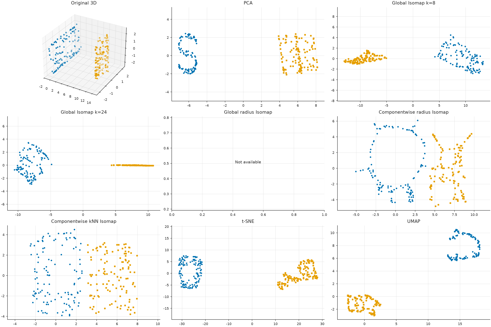
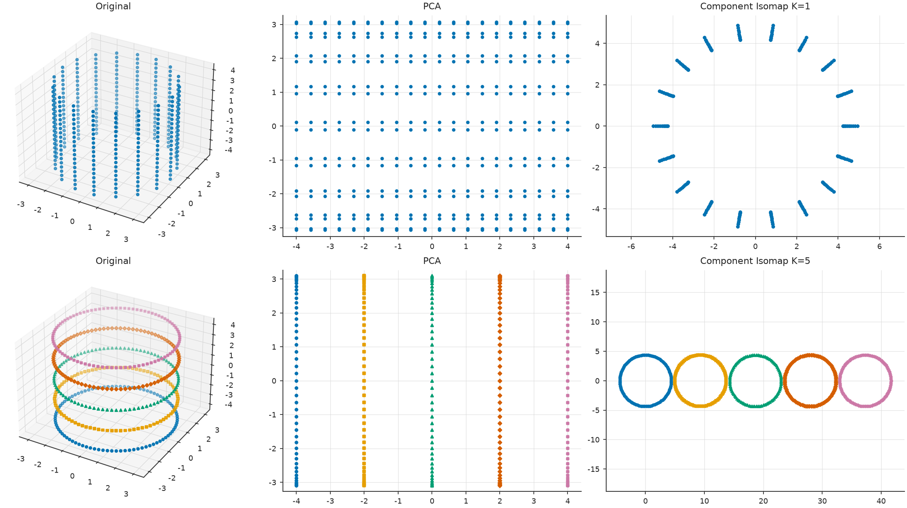

<!-- _class: cover -->
# Componentwise kNN-Isomap
## From neighborhood graphs to constrained manifold embeddings

**Mathematical lecture · ProximityGraphs-Isomap · 19 October 2026**

Graph theory · Geodesic distances · Classical MDS · Orthogonal alignment · Topology

**Data:** versioned EXP-010 and EXP-011 full runs, seed 20261018. **New algorithmic claims:** clearly marked as proposed.

---

# What you should understand at the end

1. Why Isomap estimates **geodesic distances** using graph shortest paths.
2. How the symmetrized \(k\)-nearest-neighbor graph determines the partition.
3. How classical MDS follows from a centered Gram matrix.
4. Why independent embeddings are not positioned relative to one another.
5. Why **rigid motions preserve computed within-component distances**.
6. How to quantify and constrain **intercomponent placement**.
7. What our EXP-011 implementation actually does—and what remains to be developed.

---

# Problem setup: multiple manifolds

Let

$$
X=\{x_1,\ldots,x_n\}\subset\mathbb R^D,\qquad
Y=\{y_1,\ldots,y_n\}\subset\mathbb R^d,\quad d\ll D.
$$

Suppose observations come from a disjoint union of supports

$$
M=M_1\sqcup M_2\sqcup\cdots\sqcup M_K.
$$

We want to preserve the **intrinsic geometry inside** each \(M_c\), but **cross-manifold intrinsic geodesic distances are not finite**.

Between distinct components we may still measure **ambient** distances, \(\|x_i-x_j\|_2\). These objectives are fundamentally different.

---

# Why ordinary global Isomap is troublesome

**Classical Isomap:** neighbor graph \(\rightarrow\) shortest-path matrix \(\rightarrow\) classical multidimensional scaling (MDS).

When \(G\) is disconnected, some \(d_G(i,j)=+\infty\). A single standard MDS matrix cannot use these entries directly.

Some implementations **repair** a disconnected graph by inserting bridging edges. Then global geodesics use connections **not present in the original neighbor graph**.

**Alternative:** decompose first, unfold each graph component independently, then solve the *placement problem* explicitly.

This idea is part of existing multi-manifold-learning literature; it is **not novel by itself**.

---

# The algorithm, in one picture

$$
\boxed{
X\;\xrightarrow[\text{distance}]{\text{kNN graph}}\;
C_1,\ldots,C_K
\;\xrightarrow[\text{per component}]{\text{shortest paths}}\;
D_1,\ldots,D_K
\;\xrightarrow[\text{per component}]{\text{MDS}}\;
Z_1,\ldots,Z_K
\;\xrightarrow{\text{rigid placement}}\;Y
}
$$

**Separate questions:**

- **Discovery:** which observations should belong together?
- **Unfolding:** how should each discovered piece be represented in \(\mathbb R^d\)?
- **Alignment:** where should each piece be placed relative to the others?

We will derive every arrow.

---

# Step 1 — Nearest-neighbor definition

For each \(i\), let \(N_k(i)\) be the indices of the \(k\) nearest *other* observations under Euclidean ambient distance.

Using the **symmetrized union kNN graph**, define

$$
\{i,j\}\in E_k
\quad\Longleftrightarrow\quad
j\in N_k(i)\ \text{or}\ i\in N_k(j).
$$

If an edge exists, assign its Euclidean length:

$$
w_{ij}=\|x_i-x_j\|_2.
$$

The union rule is distinct from **mutual kNN**, which requires *both* neighbor relations. These choices have different connectivity behavior.

---

# Why the graph is weighted

Consider three observations \(a,b,c\). A path \(a\rightarrow b\rightarrow c\) has cost

$$
L(a,b,c)=\|x_a-x_b\|_2+\|x_b-x_c\|_2.
$$

The graph-shortest distance is

$$
d_G(i,j)=
\min_{i=v_0,\ldots,v_q=j}
\sum_{\ell=0}^{q-1}\|x_{v_\ell}-x_{v_{\ell+1}}\|_2.
$$

When the neighborhood edges follow the manifold, graph distances can approximate surface/geodesic distances that are **longer than** direct ambient chords.

**But:** edges that shortcut across nearby folds spoil the approximation.

---

# Step 2 — Connected components

The undirected graph \(G_k=(V,E_k,w)\) induces a partition

$$
V=C_1(k)\sqcup\cdots\sqcup C_{K(k)}(k).
$$

We may compute this partition by depth-first search or a sparse connected-component routine.

For a fixed dataset and deterministic tie-breaking,

$$
E_k\subseteq E_{k+1}
\quad\Longrightarrow\quad K(k+1)\le K(k).
$$

**As \(k\) increases, graph components can merge but cannot split.**

This statement concerns graph connectivity—not whether the resulting groups equal the true generating manifolds.

---

# What can go wrong when choosing \(k\)?

**Too small:** locally sparse manifolds fragment, creating too many components and infinite paths between fragments.

**Too large:** points on different supports can become nearest neighbors, merging manifolds into one connected graph.

**Intermediate \(k\):** within-manifold connectivity may coexist with no inter-manifold bridges.

This interval need not exist when manifolds nearly intersect, density varies strongly, or high-dimensional nearest neighbors become unreliable.

**EXP-013 proposal:** map the entire \(k\)-dependent component and distortion landscape, instead of picking one attractive example.

---

# An exact finite-sample recovery condition

For true generating groups \(X_1,\ldots,X_K\), a symmetrized kNN partition equals them if:

1. Each induced within-group kNN subgraph is **connected**.
2. Every point's chosen \(k\) neighbors are **inside its own true group**.

Under these two conditions, the graph has exactly those \(K\) components.

**This is a sufficient condition, not an unsupervised test.** It uses known generating groups to state a guarantee; real data do not supply these groups.

Contrast radius graphs, for which a sufficient recovery interval follows from the largest within-group MST edge and smallest cross-group distance.

---

# A crucial EXP-011 implementation detail

The current experiment calls its method **componentwise kNN Isomap**, but its stages are:

1. Find components using a **radius graph** (rings, cylinder, torus), or a **supplied-\(K\) MST cut** (Swiss/S-curve pairs).
2. **Rebuild a symmetrized 10-NN graph inside each detected component**.
3. Compute its graph shortest paths.
4. Apply MDS and place embeddings in separated strips.

**Therefore this run does not test unsupervised kNN component discovery.**

A new specialized experiment should explicitly vary both detection \(k_{\rm detect}\) and unfolding \(k_{\rm embed}\).

---

# Two neighborhood parameters—not necessarily one

For a fully kNN-driven pipeline, it is useful to distinguish

$$
k_{\rm detect}\quad\text{and}\quad k_{\rm embed}.
$$

- \(k_{\rm detect}\) determines candidate manifold components.
- \(k_{\rm embed}\) determines shortest-path geometry *inside* each candidate component.

We can set them equal for a simple algorithm, but the two choices answer different geometric questions.

Using an induced subgraph \(G_{k_{\rm detect}}[C_c]\) is also different from **recomputing** \(k_{\rm embed}\)-NN within the selected component; specify which is used.

---

<!-- _class: visual -->
# EXP-010 — Why rings and a cylinder are different

**Executed EXP-010:** the sampled cylinder is one ideal connected surface; the five rings are distinct connected supports.

---

<!-- _class: visual -->
# EXP-010 — Radius affects connectivity and H1

**Observed result:** β₀ counts graph components, whereas β₁ counts independent VR loops. Smaller radius does not convert one cylinder into five genuine supports.

---

# Step 3 — Shortest paths within a component

Let \(C_c\) have \(n_c\) observations and a **connected** local kNN graph \(G_c\).

Construct the matrix

$$
D_c=(d^{G_c}_{ij})_{i,j\in C_c}\in\mathbb R^{n_c\times n_c}.
$$

The graph shortest-path distance is finite within a connected \(C_c\), and the diagonal is zero.

**Important assumption:** we need local enough edges to avoid shortcuts yet enough edges to connect the sampled manifold. Neither property is guaranteed by choosing \(k\) alone.

---

# Why geodesics matter: the unrolling intuition

A Swiss roll is a bent two-dimensional sheet. Nearby points in \(\mathbb R^3\) can be far apart **along the sheet**.

- PCA tries to preserve variance in a single linear plane.
- Direct Euclidean distance MDS would attempt to preserve ambient chords.
- Isomap replaces ambient chords with **graph approximations to surface geodesics**.

When those graph distances approximate true intrinsic geodesics, MDS can recover a useful intrinsic coordinate representation.

**A wrong graph cannot be repaired by MDS.**

---

# Step 4 — Classical MDS: begin with coordinates

Let \(z_1,\ldots,z_m\in\mathbb R^d\) be *unknown* centered coordinates,

$$
\sum_{i=1}^{m} z_i=0.
$$

Define the Gram matrix

$$
B_{ij}=\langle z_i,z_j\rangle,\qquad B=ZZ^\top.
$$

The squared Euclidean distance satisfies

$$
D_{ij}^2=\|z_i-z_j\|_2^2
=B_{ii}+B_{jj}-2B_{ij}.
$$

**Goal:** recover a good coordinate matrix \(Z\) from distances \(D\), without knowing the original coordinates.

---

# The centering matrix and why it works

Define

$$
H=I-\frac1m\mathbf 1\mathbf1^\top.
$$

Then

$$
H^\top=H,\qquad H^2=H,\qquad H\mathbf1=0.
$$

For an arbitrary coordinate matrix \(W\), \(HW\) subtracts the row mean.

Multiplying the squared-distance identity on both sides by \(H\), the diagonal terms vanish because they involve the all-ones vector:

$$
HD^{\circ2}H=-2HBH.
$$

---

# Derivation: the double-centered Gram matrix

For centered \(Z\), we have \(HZ=Z\), hence \(HBH=B\). Therefore

$$
\boxed{B=-\frac12 HD^{\circ2}H.}
$$

**This is the central mathematical identity behind classical MDS.**

Starting from graph-geodesic distances \(\widehat D_c\), form

$$
\widehat B_c=-\frac12 H_c\widehat D_c^{\circ2}H_c.
$$

Because graph distances need not be exactly Euclidean in \(d\) dimensions, \(\widehat B_c\) may contain negative eigenvalues.

---

# MDS as a spectral approximation

Diagonalize the symmetric matrix

$$
\widehat B_c=U\Lambda U^\top,\qquad
\lambda_1\ge\cdots\ge\lambda_{n_c}.
$$

Keep up to \(d\) leading **positive** eigenvalues:

$$
\boxed{Z_c=U_{[:,1:d]}\operatorname{diag}\!
(\sqrt{\max(\lambda_1,0)},\ldots,\sqrt{\max(\lambda_d,0)}).}
$$

If fewer than \(d\) eigenvalues are positive, pad with zero coordinates.

This is the best **positive-semidefinite rank-\(d\)** approximation of \(\widehat B_c\) in Frobenius norm. It does **not** directly minimize the raw unsquared pairwise-distance stress.

---

# What exactly does classical MDS optimize?

Writing \(Z\in\mathbb R^{m\times d}\),

$$
\min_Z\|\widehat B_c-ZZ^\top\|_F^2
$$

is solved by the truncated positive eigendecomposition.

This is **strain minimization** in a centered Gram-matrix representation.

A separate objective is **stress**:

$$
\sum_{i<j}\left(\|z_i-z_j\|_2-\widehat d_{ij}\right)^2.
$$

They are not the same optimization problem. When presenting Isomap, do not claim its classical MDS step globally minimizes raw distance stress.

---

# Step 5 — Apply MDS independently

For each candidate component \(C_c\):

$$
G_c\ \to\ D_c\ \to\
B_c=-\tfrac12H_cD_c^{\circ2}H_c\ \to\ Z_c.
$$

This gives \(Z_c\in\mathbb R^{n_c\times d}\).

**There is no distance matrix linking distinct \(C_c\) via source-manifold geodesics.** Their independent MDS solutions thus have no common translation or orientation.

This is why stacking all \(Z_c\) at the origin—even when each component individually unfolds well—can produce overlapping geometry.

---

# A freedom we can exploit: rigid motions

Choose an orthogonal matrix \(Q_c\in O(d)\), \(Q_c^\top Q_c=I\), and a translation \(t_c\in\mathbb R^d\).

Set

$$
\boxed{Y_c=Z_cQ_c+\mathbf1t_c^\top.}
$$

\(Q_c\) allows rotations **and reflections**, while \(t_c\) repositions the cloud.

A **single global rigid motion** cannot change cross-component relationships, but **independent rigid motions** can.

All of this happens *after* the independent Isomap embedding is computed.

---

# Proof: the internal distances cannot change

For \(i,j\in C_c\),

$$
y_i-y_j=(z_i-z_j)Q_c.
$$

Consequently,

$$
\begin{aligned}
\|y_i-y_j\|_2^2
&=(z_i-z_j)Q_cQ_c^\top(z_i-z_j)^\top\\
&=(z_i-z_j)(z_i-z_j)^\top\\
&=\|z_i-z_j\|_2^2.
\end{aligned}
$$

**Therefore rigid placement preserves every pairwise Euclidean distance of the computed embedding exactly.**

It does **not** prove Isomap recovered the true input manifold metric.

---

# What rigid motions do NOT preserve

For \(i\in C_c\), \(j\in C_\ell\), \(c\ne\ell\),

$$
\|y_i-y_j\|_2
=\|z_iQ_c+t_c-z_jQ_\ell-t_\ell\|_2.
$$

This distance depends on **relative rotations and translations**.

Therefore independent positioning can:

- destroy ambient cross-component distance fidelity;
- introduce or prevent component overlap;
- alter the Vietoris–Rips filtration of the **union** of projected components.

These are the variables in the proposed placement optimization.

---

# Step 6 — Defining geometric separation

A graph partition only separates *vertices in the graph*, not necessarily the projected shapes.

A strong geometric requirement for \(c\ne\ell\) is

$$
\boxed{\operatorname{dist}\bigl(\operatorname{conv}(Y_c),
\operatorname{conv}(Y_\ell)\bigr)\ge \mu>0.}
$$

Here

$$
\operatorname{dist}(A,B)=\inf_{a\in A,\;b\in B}\|a-b\|_2.
$$

Using convex hulls avoids the error of calling two point clouds 'separated' merely because no source graph edge connects them.

---

# Constructive guarantee: disjoint strips

For each centered \(Z_c\), choose a translation such that the first coordinates lie inside a strip \(I_c=[a_c,b_c]\).

Order the components so that

$$
a_{c+1}-b_c\ge\mu.
$$

Since every convex combination retains a first coordinate inside the same interval \(I_c\), each convex hull lies within its strip.

For points \(p\in\operatorname{conv}(Y_c)\), \(q\in\operatorname{conv}(Y_\ell)\), the horizontal difference is at least \(\mu\), and

$$
\|p-q\|_2\ge |p_1-q_1|\ge\mu.
$$

**Proved:** strip placement guarantees clearance; **not proved:** that it minimizes cross-component distance distortion.

---

# EXP-011: separation may be expensive

For the five rings in the *executed* EXP-011 run:

| Method | Intrinsic stress ↓ | Centroid stress ↓ | Intersecting hull pairs ↓ |
|---|---:|---:|---:|
| PCA | 0.463 | **0.414** | 0 |
| Global Isomap \(k=24\) | 0.250 | 0.996 | 10 |
| Componentwise kNN Isomap | **0.245** | 2.311 | **0** |
| UMAP | 0.253 | 6.263 | 0 |

**Tradeoff:** the componentwise method unfolds/separates the rings here, but its simple strip placement distorts the component centroids.

*Run:* \`20261019T061001Z-full\`, one deterministic seed. No significance claim.

---

<!-- _class: visual -->
# Real EXP-011 — Five rings across the methods

The 2D gallery corresponds to the GitHub-published run; each panel uses the same 450 observed source points.

---

# Step 7 — Centroid-distance preservation

Let \(\bar x_c\) be the source centroid and \(\bar y_c\) the projected centroid. Consider

$$
\mathcal L_{\rm cent}(Y)=
\sum_{c<\ell}w_{c\ell}
\left(\|\bar y_c-\bar y_\ell\|_2-\|\bar x_c-\bar x_\ell\|_2\right)^2.
$$

A normalized version divides by
\(\sum_{c<\ell}w_{c\ell}\|\bar x_c-\bar x_\ell\|_2^2\).

But centroid distances only describe a **coarse arrangement**; they do not determine component orientations or preserve every intercomponent point distance.

---

# A useful limitation: centroids do not fix orientation

If each independent embedding is centered, \(\bar z_c=0\), then

$$
\bar y_c=\bar z_cQ_c+t_c=t_c.
$$

Thus

$$
\mathcal L_{\rm cent}(Y)=
\sum_{c<\ell}w_{c\ell}
\left(\|t_c-t_\ell\|-\|\bar x_c-\bar x_\ell\|\right)^2.
$$

**The centroid loss is independent of every \(Q_c\)!**

Therefore centroid stress alone cannot select optimal orientations. A meaningful placement algorithm needs separation constraints and possibly landmark or all-pair cross-component terms.

---

# Initial centroid placement via classical MDS

Take the \(K\times K\) matrix of original centroid distances,

$$
D^{\rm cent}_{c\ell}=\|\bar x_c-\bar x_\ell\|_2.
$$

Apply classical MDS to \(D^{\rm cent}\) in dimension \(d\). The resulting \(T\in\mathbb R^{K\times d}\) supplies initial translations \(t_c\).

Because \(K\) original centroids may have affine dimension above \(d\), exact reproduction of **all** centroid distances is generally impossible.

Then optimize the component orientations and translations **subject to positive geometric clearance**.

---

# Stronger loss: intercomponent landmarks

Pick representative landmarks \(L_c\subset C_c\). Define

$$
\mathcal L_{\rm cross}(Q,t)=
\sum_{c<\ell}\sum_{i\in L_c}\sum_{j\in L_\ell}
w_{ij}\left(
\|z_iQ_c+t_c-z_jQ_\ell-t_\ell\|
-\|x_i-x_j\|\right)^2.
$$

This loss **does** depend on orientation \(Q_c\).

It matches **ambient cross-component distances**—not intrinsic geodesics, which are disconnected across different manifold supports.

Landmarks control cost, but must be selected without leaking evaluation targets.

---

# The proposed constrained optimization

The intended next method solves

$$
\boxed{
\begin{aligned}
\min_{Q_c,t_c}\quad &\mathcal L_{\rm cross}(Q,t)
\\
\text{subject to}\quad &Q_c^\top Q_c=I_d,\quad \forall c,\\
&\operatorname{dist}\bigl(\operatorname{conv}(Y_c),
\operatorname{conv}(Y_\ell)\bigr)\ge\mu,\quad c\ne\ell .
\end{aligned}
}
$$

**Implemented in EXP-011:** independent Isomap and *feasible strip placement*.

**Not implemented in EXP-011:** global optimization of this constrained objective. Do not describe the strip layout as an optimizer or an original algorithmic invention.

---

# Separation–distortion frontier

For a chosen target clearance \(\mu\), define the ideal value

$$
V(\mu)=\inf_{\{Q_c,t_c\}\,:\,
\operatorname{dist}(\operatorname{conv}Y_c,\operatorname{conv}Y_\ell)\ge\mu}
\mathcal L_{\rm cross}(Q,t).
$$

If \(0\le\mu_1\le\mu_2\), then the feasible set for \(\mu_2\) is contained in that for \(\mu_1\). Hence

$$
\boxed{V(\mu_1)\le V(\mu_2).}
$$

This monotonicity is **elementary**. A publishable research problem would need stronger bounds, an effective optimizer, or robust comparative evidence.

---

# Step 8 — Evaluating internal distances

When synthetic ground-truth within-manifold geodesics \(g_{ij}\) are available, use

$$
S_{\rm in}=
\sqrt{
\frac{\sum_c\sum_{i<j\in C_c}
(\|\tilde y_i-\tilde y_j\|_2-g_{ij})^2}
{\sum_c\sum_{i<j\in C_c}g_{ij}^{\,2}}
}.
$$

To handle arbitrary scales across embeddings, EXP-011 first applies **a common ambient-within-distance RMS scale factor** \(s(Y)\) to obtain \(\tilde Y=s(Y)Y\).

**Interpretation:** this evaluates intrinsic distances in a specified synthetic geometry. It does **not** replace graph-connectivity diagnostics.

---

# Step 9 — Evaluating intercomponent placement

The distinct manifolds are disconnected; we compare their projected distances with finite source **ambient** distances:

$$
S_{\rm out}=
\sqrt{
\frac{\sum_{c<\ell}\sum_{i\in C_c,j\in C_\ell}
(\|\tilde y_i-\tilde y_j\|-\|x_i-x_j\|)^2}
{\sum_{c<\ell}\sum_{i\in C_c,j\in C_\ell}
\|x_i-x_j\|^2}
}.
$$

Complement this with centroid stress and **convex-hull intersection counts**.

If a method has low \(S_{\rm in}\) but high \(S_{\rm out}\), it has unfolded the pieces while losing their relative ambient placement.

---

# Step 10 — Trustworthiness of neighborhoods

Let \(U_i(k)\) be points that enter the \(k\)-nearest-neighbor set of \(y_i\) but were not among the original \(k\) nearest neighbors of \(x_i\).

With \(r_i(j)\) the original-space neighbor rank,

$$
T(k)=1-\frac{2}{nk(2n-3k-1)}
\sum_{i=1}^n\sum_{j\in U_i(k)}(r_i(j)-k).
$$

\(T(k)\approx1\) means **few false neighbors introduced by projection**.

This is useful for t-SNE and UMAP, whose objectives primarily favor neighborhood structure. High trustworthiness does **not** imply correctly preserved centroids or nonoverlapping hulls.

---

<!-- _class: visual -->
# Real EXP-011 — Local trustworthiness

One completed run: t-SNE and UMAP achieve high neighborhood fidelity, even when global metric placement differs.

---

<!-- _class: visual -->
# Real EXP-011 — Intrinsic-distance error

The torus has no reported analytic surface-geodesic stress in this protocol; it must not be treated as zero.

---

<!-- _class: visual -->
# Real EXP-011 — Centroid placement error

For a single connected component centroid-distance stress is undefined; no such number is claimed.

---

# The measured methods target different properties

**EXP-011, single run:**

- On **five rings**, componentwise kNN-Isomap: intrinsic stress \(0.245\); trustworthiness \(0.944\).
- On **five rings**, t-SNE: intrinsic stress \(0.323\); trustworthiness \(\approx0.9997\).
- On **five rings**, UMAP: intrinsic stress \(0.253\); trustworthiness \(\approx0.9998\).
- On the **S-curve pair**, componentwise kNN-Isomap has lower intrinsic stress \(0.312\) than PCA \(0.372\) and global Isomap \(k=8\), \(0.355\).
- On the **Swiss-roll pair**, componentwise kNN-Isomap stress \(0.729\) is **not** a convincing improvement over PCA \(0.720\).

No universal winner; each metric and geometry answers a different question.

---

<!-- _class: visual -->
# Real EXP-011 — Rotated Swiss-roll pair

A difficult negative example: the componentwise kNN graph does not automatically give low intrinsic error on these rotated random samples.

---

<!-- _class: visual -->
# Real EXP-011 — S-curve pair

An example where the componentwise kNN method has relatively lower within-manifold stress in this run.

---

# Does a good 2D embedding preserve topology?

Not necessarily.

For a point cloud \(X\), the Vietoris–Rips complex is

$$
\operatorname{VR}_r(X)=\{
\sigma\subseteq X:\max_{i,j\in\sigma}\|x_i-x_j\|\le r\}.
$$

- \(\beta_0(r)\): connected components.
- \(\beta_1(r)\): independent 1-cycles *after filling graph triangles*.
- The VR persistence of \(Z_c\) is unchanged under its **rigid motion**.
- But the ambient-cloud VR persistence of \(X_c\) can differ substantially from that of **its Isomap embedding** \(Z_c\).

A torus surface also cannot be faithfully flattened into the plane without topological distortion.

---

<!-- _class: visual -->
# Real EXP-010 — Original, PCA and componentwise Isomap

This control distinguishes a continuous cylinder from five disconnected circular supports.

---

# Computational complexity

Let \(n=\sum_c n_c\) and \(m_c=|E(G_c)|\).

- Brute-force neighbor distances: \(O(n^2D)\) time, potentially \(O(n^2)\) memory (algorithm/data dependent).
- Build symmetrized kNN edges: typically \(O(nk)\) graph storage after neighbor search.
- Repeated shortest paths (one source per vertex): roughly \(O(\sum_c n_c(m_c+n_c)\log n_c)\) with binary-heap Dijkstra, depending on implementation.
- Full eigendecomposition for each component: \(O(\sum_c n_c^3)\) time and \(O(\sum_c n_c^2)\) memory.
- Computing all cross-component pair distortions: \(O(\sum_{c<\ell}n_cn_\ell d)\).

**Why componentwise helps:** \(\sum_c n_c^3\le n^3\), sometimes much smaller; cost of graph discovery and placement remains.

---

# The experimental design for EXP-013 (proposed)

**Separate the two stages** rather than mixing effects:

$$
k_{\rm detect}\in\{4,6,8,10,12,16,20,24,32\}
$$

and

$$
k_{\rm embed}\in\{4,6,8,10,12,16,20,24,32\}.
$$

Compare at least three placement choices: unaligned, guaranteed strips, and **optimized** centroid/landmark placement *if implemented*.

Evaluate connected-component count, partition accuracy (synthetic evaluation only), within-stress, trustworthiness, centroid/cross stress, clearance, running time and errors.

**These are future experiment settings, not completed EXP-013 results.**

---

# Failure modes to report—not hide

1. **Overfragmentation:** sparse graph, small \(k_{\rm detect}\), \(K\) too large.
2. **False bridges:** manifold folds or nearby supports merge at large \(k_{\rm detect}\).
3. **Graph shortcut bias:** wrong graph geodesics even when partition is correct.
4. **Low-dimensional impossibility:** e.g., a torus surface cannot embed injectively in \(\mathbb R^2\) as a faithful continuous surface.
5. **Arbitrary alignment:** good internal geometry but huge cross/centroid stress.
6. **Evaluation leakage:** choosing \(k\) or \(K\) with generating labels, then claiming unsupervised recovery.
7. **Single-seed optimism:** cherry-picked 2D galleries do not prove robustness.

---

# Comparison with known methods

**Classical and established components of this pipeline:**

- Isomap: Tenenbaum, de Silva & Langford (2000).
- Disconnected/multi-manifold approaches: D-C Isomap; M-Isomap; S-Isomap++.
- Neighborhood visualization: t-SNE; UMAP.
- Topological embedding controls: TopoMap and related persistence-aware methods.

**Not an established novelty claim:** independent kNN-Isomap alone.

**Research target:** a *specified and tested* separation-constrained placement objective that preserves each computed internal embedding while minimizing relative-placement distortion.

---

# Three mathematical conclusions

**1. Graph phase:** connected components of symmetrized \(k\)-NN form a nested family as \(k\) increases, under deterministic neighbor ranking.

**2. Spectral phase:** classical MDS is obtained through
\(\widehat B=-\tfrac12H\widehat D^{\circ2}H\), then a positive rank-\(d\) spectral approximation.

**3. Alignment phase:** independent orthogonal transformations and translations preserve every computed intracomponent pair distance but alter cross-component placement.

**Research question:** how can we optimize the third phase with a positive hull clearance and a controlled ambient-distance cost?

---

# Source and research status

**Versioned run consulted**

- EXP-010: \`results/010-radius_density_and_rings/runs/20261019T061001Z-full/\`.
- EXP-011: \`results/011-isomap_baselines/runs/20261019T061001Z-full/\`.
- Actual corresponding PNGs are embedded on the visual slides. EXP-011's \`metadata.json\` verifies **UMAP was installed**.
- The original EXP-011 code uses a radius or supplied-\(K\) MST partition, then rebuilds a 10-NN graph internally.
- **EXP-013 is proposed, not run or measured.**

The seminar should distinguish **proved mathematical identities**, **one-run empirical observations** and **proposed constrained optimization**.

---

<!-- _class: cover -->
# Questions for the professor

1. Should detection use a single \(k\) or separate \(k_{\rm detect}\) and \(k_{\rm embed}\)?
2. Which notion of **geometric separation** is appropriate: point clouds, convex hulls, or support estimates?
3. Should the placement objective preserve **centroid distances**, intercomponent landmarks, or all pairwise ambient distances?
4. What stronger result or benchmark would distinguish the project from prior multi-manifold Isomap methods?

$$
\boxed{
\text{graph recovery}\ \to\ \text{geodesic MDS}\ \to\
\text{separation–distortion optimization}
}
$$
