<!-- _class: cover -->
# Separation-Constrained Isomap
## Geometric dimensionality reduction for disconnected manifolds

**Research presentation · 18 October 2026**

Proximity graphs · Geodesic Isomap · Separation constraints · TDA

Exploratory research; no general superiority or novelty claim.

---

# Main question

Suppose data in $\mathbb R^D$ are sampled from several disconnected manifolds.

Can we find a representation in $\mathbb R^d$ that simultaneously:

1. Preserves within-manifold geodesic geometry;
2. Keeps different components **geometrically disjoint**;
3. Minimizes distortion of their relative ambient positions?

**Central point:** graph connectivity, non-overlap, and metric fidelity are different properties.

---

# The radius-proximity graph

$$
G_r=(V,E_r),\quad (i,j)\in E_r
\iff 0<\|x_i-x_j\|_2\le r.
$$

Weighted edges carry Euclidean lengths $w_{ij}=\|x_i-x_j\|_2$.

$$
V=C_1(r)\,\dot\cup\,\cdots\,\dot\cup\,C_{K(r)}(r).
$$

Small $r$: fragmented graph. Intermediate $r$: candidate manifold partition. Large $r$: unwanted inter-manifold bridges.

The threshold is **$r$**, not $2r$ as in radius-ball intersection graphs.

---

# A deterministic component-recovery window

For known sample groups $X_1,\dots,X_K$, let

$$
b=\max_k \max_{e\in{\rm MST}(X_k)}w(e),\qquad
\delta=\min_{k\ne\ell}\min_{x\in X_k,\;x'\in X_\ell}\|x-x'\|_2.
$$

Every radius $r$ in the interval

$$
\boxed{b\le r<\delta}
$$

recovers each sampled group as one component without cross-group edges. Such a radius exists **if and only if** $b<\delta$.

**Warning:** group-specific MST thresholds use labels in synthetic diagnostics. They are not an unsupervised selection rule.

---

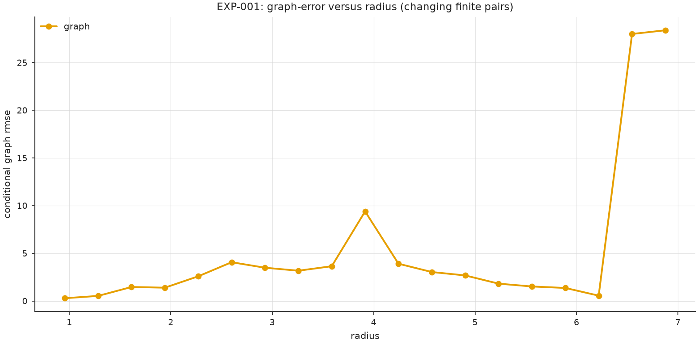
# EXP-001 — Radius filtration

Changing $r$ changes the graph and which pairs have finite graph distances.

Errors calculated on *only connected pairs* are not directly comparable when the set of those pairs changes.

**Recorded run:** manual-full-20261018.

---

# Isomap inside each component

Within graph component $C_k$, the shortest-path proxy for geodesic distance is

$$
d_{G_k}(i,j)=\min_{\pi:i\leadsto j}\sum_{(u,v)\in\pi}w_{uv}.
$$

Classical MDS of this matrix uses

$$
B_k=-\tfrac12H_kD_{G_k}^{\circ2}H_k,\qquad
H_k=I-\frac1{n_k}\mathbf1\mathbf1^\top.
$$

Retain the leading two nonnegative eigenpairs:

$$
Z_k=U_{k,1:2}\Lambda_{k,1:2}^{1/2}.
$$

Shortest-path estimates can be inaccurate if the graph fragments or admits manifold shortcuts.

---

# Hybrid MDS versus componentwise Isomap

**Global hybrid MDS** fits one point cloud with dissimilarities

$$
\Delta_{ij}=
\begin{cases}
d_{G_k}(i,j),&i,j\in C_k,\\
\|x_i-x_j\|_2,&i\in C_k,\ j\in C_\ell,\ k\ne\ell.
\end{cases}
$$

It compromises between within-component and across-component errors.

**Componentwise Isomap** instead unfolds each $C_k$ independently, then aligns whole shapes.

The hybrid matrix $\Delta$ is not necessarily a metric; a global optimization can place distinct graph components on crossing 2D curves.

---

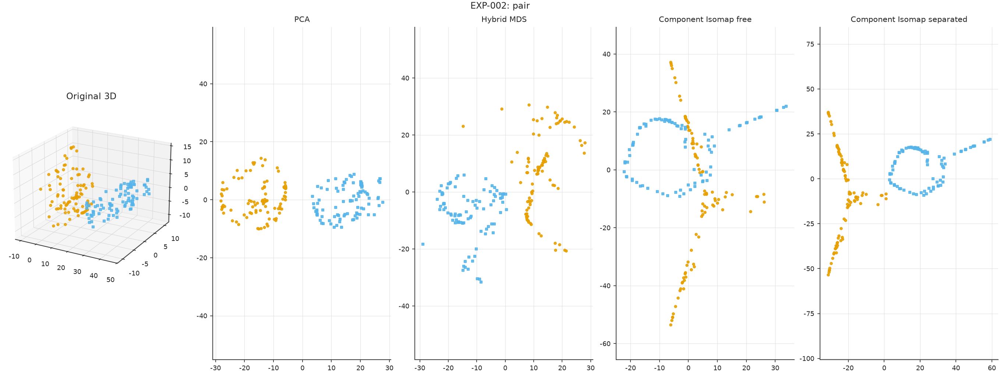
# EXP-002 — Global versus independent embeddings

The reconstructed comparison evaluates PCA, hybrid MDS, and componentwise Isomap.

**Issue:** fitting one embedding globally may create projected overlaps even when the graph is disconnected.

Neither a scatterplot nor a single stress value is sufficient evidence of geometric fidelity.

---

# EXP-003 — Radius sensitivity

The radius sweep includes strongly disconnected and near-complete graphs.

There can be a narrow intermediate region with relatively small intrinsic distortion.

**Oracle caveat:** choosing a radius by minimizing error against synthetic true geodesics is a *diagnostic*, not an automatic procedure.

---

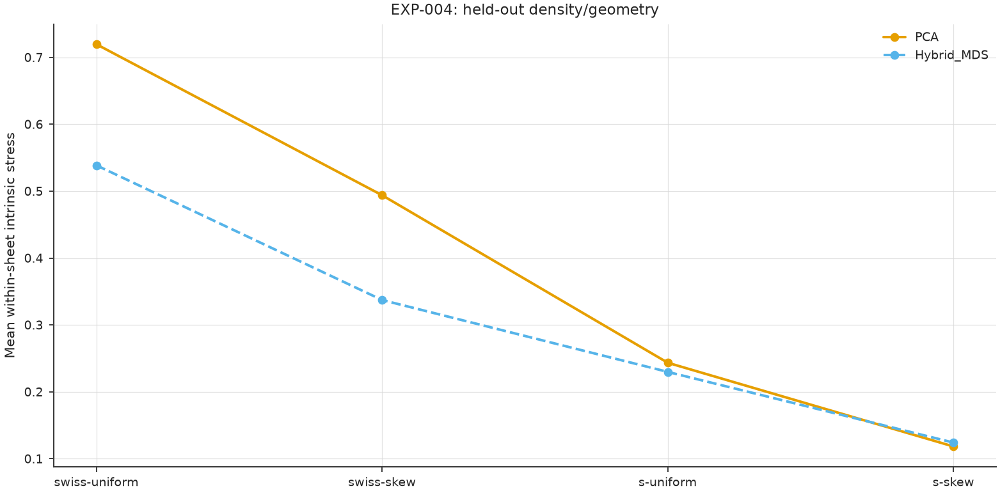
# EXP-004 — Sampling-density transfer

A single global radius does not necessarily transfer to uneven or skewed sampling.

Sparse areas can remain disconnected when dense areas already contain too many edges.

A density-adaptive radius is a hypothesis to test against established kNN neighborhood construction.

---

# Two stress measures, not one

For *true* within-manifold reference geodesics $g_{ij}$, define

$$
S_{\rm in}(Y)=
\sqrt{\frac{\sum_k\sum_{i<j\in C_k}
(\|y_i-y_j\|-g_{ij})^2}
{\sum_k\sum_{i<j\in C_k}g_{ij}^{\,2}}}.
$$

Between disconnected manifolds there are **no finite intrinsic geodesics**. Compare against ambient distances instead:

$$
S_{\rm out}(Y)=\sqrt{
\frac{\sum_{k<\ell}\sum_{i\in C_k,j\in C_\ell}
(\|y_i-y_j\|-\|x_i-x_j\|)^2}
{\sum_{k<\ell}\sum_{i\in C_k,j\in C_\ell}\|x_i-x_j\|^2}}.
$$

Lower is better; preserving one need not preserve the other.

---

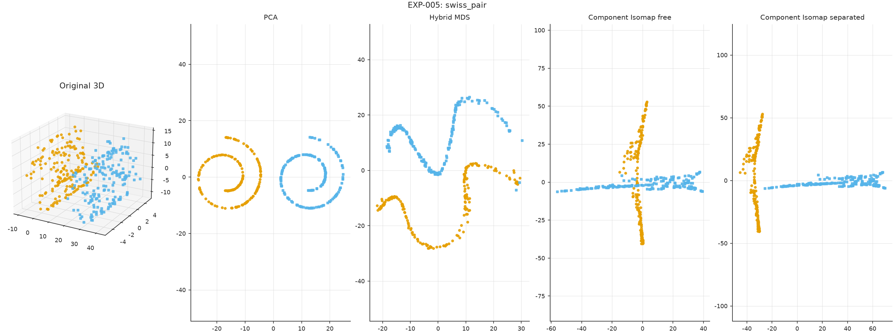
# EXP-005 — Two Swiss rolls

A disconnected source graph does **not** imply disjoint projected point clouds, curves or convex hulls.

This motivates explicit constraints on the *projected geometry*, not just the neighborhood graph.

---

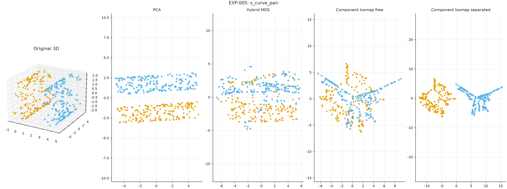
# EXP-005 — Two S-curves

The same tradeoff appears for another curved surface family.

Changing the radius can alter internal geodesic error and relative-placement distortion in opposite directions.

---

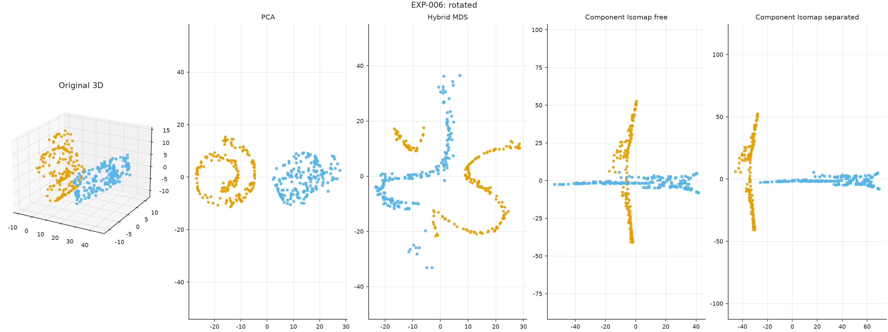
# EXP-006 — Rotated Swiss rolls

Two nonlinear surfaces with different orientations challenge a single PCA plane.

Independent Isomap removes that shared-orientation constraint, but does not determine how far apart—or at what relative angle—the surfaces should be placed.

---

# Rigid alignment of independent embeddings

Let $Z_k\in\mathbb R^{n_k\times d}$ be the computed embedding of $C_k$.

$$
\boxed{Y_k=Z_kQ_k+\mathbf1t_k^\top,\qquad Q_k^\top Q_k=I_d.}
$$

For $i,j\in C_k$,

$$
\|y_i-y_j\|_2^2=(z_i-z_j)Q_kQ_k^\top(z_i-z_j)^\top
=\|z_i-z_j\|_2^2.
$$

**Proved exactly:** orthogonal alignment and translation preserve every computed internal pairwise distance.

**Not proved:** that Isomap distances already equal the true manifold geodesics.

---

# A non-overlap requirement

For desired clearance $\mu>0$, impose

$$
\operatorname{dist}(\operatorname{conv}Y_k,\operatorname{conv}Y_\ell)
\ge\mu,\qquad k\ne\ell.
$$

A feasible ordered-strip layout suffices to guarantee disjoint convex hulls, but can be far from an optimal placement.

**Key distinction:** constraining only pairs of observed points to be apart does not necessarily stop continuous projected hulls from overlapping.

---

# EXP-007 — Making the cross disappear

**Unconstrained alignment:** independently unfolded rolls can intersect in 2D.

**Constrained alignment:** two connected components remain geometrically distinct.

This improves separation but can substantially worsen distortion of their original ambient relative positions.

---

<!-- _class: compact -->
# EXP-007 — Measured tradeoff

From the versioned reconstructed full run, 360 observations:

| Method | Within intrinsic stress ↓ | Between ambient stress ↓ |
|---|---:|---:|
| PCA | 0.7588 | **0.0423** |
| Hybrid MDS | 0.5017 | 0.2640 |
| Componentwise Isomap, free | **0.0588** | 0.5343 |
| Componentwise Isomap, separated | **0.0588** | 1.5529 |

Guaranteed horizontal clearance in this run: approximately 2.2265.

**Interpretation:** rigid placement preserves independently computed internal geometry exactly, but demanding clearance can be expensive.

[Source CSV](../../results/007-component_alignment/runs/manual-full-20261018/metrics.csv)

---

# Proposed centroid-distance alignment

Let $\bar x_k$ and $\bar y_k$ denote original and projected centroids. Consider

$$
\min_{\{Q_k,t_k\}}\sum_{k<\ell}w_{k\ell}
\left(
\|\bar y_k-\bar y_\ell\|-
\|\bar x_k-\bar x_\ell\|
\right)^2
$$

subject to rigid motions and positive convex-hull clearance.

This preserves coarse component placement but **centroids alone do not capture shapes, orientations or nearest boundary distances**.

Alternative terms could use selected landmarks or all cross-component distances.

---

# The separation–distortion frontier

$$
V(\mu)=\inf_{\substack{Q_k^\top Q_k=I_d,\ t_k\\
{\rm dist}({\rm conv}Y_k,{\rm conv}Y_\ell)\ge\mu}}
S_{\rm out}(Y).
$$

For $\mu_1\le\mu_2$ the feasible set shrinks, so

$$
\boxed{V(\mu_1)\le V(\mu_2).}
$$

**This monotonicity is elementary—not a new theorem.**

The research problem is to obtain useful algorithms, bounds, or performance evidence for the frontier.

---

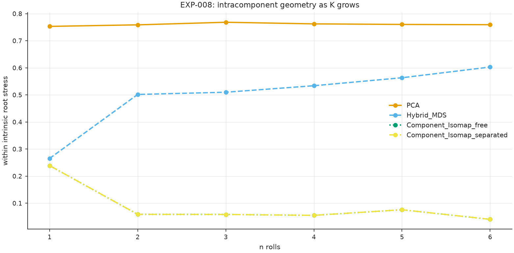
# EXP-008 — One to six Swiss rolls

Multi-component scalability is more demanding than the two-component example.

How much do the relative distances degrade as the number of separately unfolded surfaces grows?

These panels come from a reconstructed exploratory run, not a many-seed robustness study.

---

# Homology: components versus holes

The Vietoris–Rips complex is

$$
{\rm VR}_r(X)=\{\sigma\subseteq X:
\max_{i,j\in\sigma}\|x_i-x_j\|_2\le r\}.
$$

$\beta_0(r)$ counts connected components; $\beta_1(r)$ counts independent unfilled loops.

| Ideal support | $\beta_0$ | $\beta_1$ | $\beta_2$ |
|---|---:|---:|---:|
| Swiss roll strip | 1 | 0 | 0 |
| Open cylinder surface | 1 | 1 | 0 |
| Torus surface | 1 | 2 | 1 |

**These are ideal-support Betti numbers, not guaranteed finite-sample VR counts at each radius.**

---

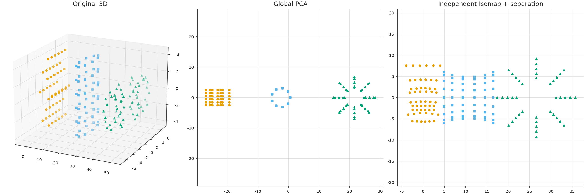
# EXP-009 — Swiss roll, cylinder and torus

The pilot sampled 172 observations and cut the Euclidean MST into **K=3 supplied** components.

Each was embedded independently, then translated/rotated to a separate strip.

A correct partition is not enough to preserve original topology.

---

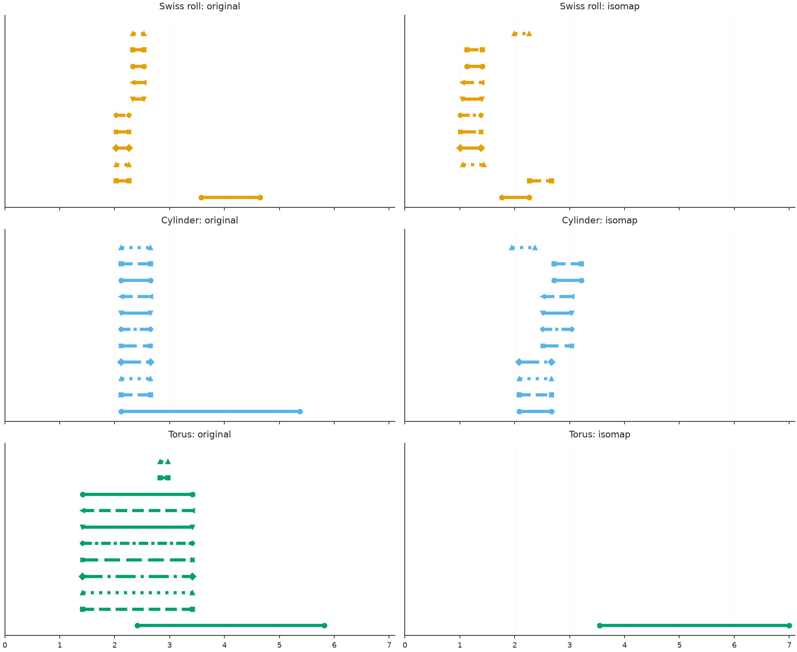
# EXP-009 — Persistent loops may be lost

Sampled long $H_1$ bars (lifetime at least one):

- Swiss roll: **1 → 0**
- Cylinder: **1 → 0**
- Torus: **9 → 1**

The filtration is truncated at $r=7$; sampling artifacts are present. The difference arises when computing independent embeddings—not from their later rigid motions.

---

<!-- _class: compact -->
# EXP-010 — Dense cylinder or five circles?

**Exploratory summary backfilled into the GitHub 010 note; original local galleries are pending binary import.**

| Synthetic dataset | $r$ | $\beta_0$ | $\beta_1$ |
|---|---:|---:|---:|
| Dense sampled cylinder, 360 points | 1.25 | 1 | 1 |
| Five truly disjoint circles, 450 points | 1.25 | 5 | 5 |

A dense cylindrical grid at $r=1.15$ exhibited 343 short-lived Rips $H_1$ classes; these are not 343 holes of the cylinder.

**Lesson:** reducing radius often fragments a connected manifold; it does not turn it into genuinely disconnected rings.

---

<!-- _class: compact -->
# EXP-011 — Other Isomap variants, t-SNE, UMAP

**Exploratory summary backfilled into the GitHub 011 note; full local galleries remain pending binary import and UMAP remains unrun.**

| Method | Five rings | Cylinder | Swiss-roll pair | S-curve pair |
|---|---:|---:|---:|---:|
| PCA | 0.463 | 0.328 | 0.720 | 0.372 |
| Global Isomap $k=8$ | 0.460 | 0.272 | 0.733 | 0.355 |
| Global Isomap $k=24$ | 0.250 | **0.271** | 0.774 | 0.435 |
| Componentwise radius Isomap | **0.245** | **0.271** | **0.676** | 0.333 |
| Componentwise kNN Isomap | **0.245** | 0.272 | 0.729 | **0.312** |
| t-SNE | 0.354 | 0.381 | 0.721 | 0.342 |

All entries are normalized within-component intrinsic stress; do **not** compare t-SNE/UMAP only on global distance error.

---

# Strong comparison protocol

**Matched data, fixed seeds, equivalent tuning budgets and provenance.**

- PCA: global linear baseline.
- Conventional Isomap: multiple kNN values, radius Isomap, landmarks.
- Independent kNN and radius Isomap: component-aware baselines.
- t-SNE and UMAP: neighborhood objectives; measure trustworthiness and continuity.
- D-C Isomap, M-Isomap, S-Isomap++: directly relevant multi-manifold prior art.
- TopoMap: relevant to $H_0$ persistence preservation.

Report the unsupervised graph's component accuracy, hull overlap, intrinsic stress, ambient placement stress, topology and runtime.

---

# What has been established?

**Mathematics:** rigid placement preserves distances inside each computed component embedding; convex-hull clearance enforces spatial separation.

**Empirical observation:** separation constraints can improve component distinctness and increase cross-component distortion.

**Topology:** preserving graph components alone does not preserve $H_1$ under Isomap.

**No current novelty claim:** independent Isomap and multi-manifold alignment are prior art. A useful contribution requires a new constrained formulation, meaningful guarantees or carefully tuned comparative improvements.

---

# Next research steps

1. Estimate the radius or partition without labels, potentially using $H_0$ persistence and local density.
2. Optimize centroid- and landmark-based rigid alignment with strict clearance.
3. Quantify the entire frontier $V(\mu)$ rather than one arbitrary gap.
4. Evaluate independent seeds, unequal densities, rotations and observation noise.
5. Integrate and rerun EXP-010/011 in a versioned environment, including real UMAP.
6. Implement and compare source-verified D-C Isomap, M-Isomap and TopoMap.

---

<!-- _class: compact -->
# EXP-010 — Cylinder versus five separate rings

[Experiment 010](../010-radius_density_and_rings/README.md): graph components and VR holes under radius and sampling changes. Original 3D/2D galleries still await source archive import.

---

# EXP-011 — Our componentwise kNN Isomap versus baselines

[Experiment 011](../011-isomap_baselines/README.md): PCA, global Isomap, componentwise kNN/radius Isomap, t-SNE; UMAP not yet executed. Original 3D/2D galleries await import.

---

# Related literature — essential comparisons

- Tenenbaum, de Silva & Langford, 2000: Isomap.
- Meng et al., 2008: D-C Isomap.
- Fan, Qiao & Zhang, 2009: M-Isomap.
- van der Maaten & Hinton, 2008: t-SNE.
- Mahapatra & Chandola, 2017: S-Isomap++.
- McInnes, Healy & Melville, 2018: UMAP.
- Doraiswamy et al., 2020: TopoMap.
- Wagner, Solomon & Bendich, 2021: DIPOLE.

**Novelty review is not finished.** These citations identify overlapping directions, not an exhaustive theorem-by-theorem comparison.

---

# Figure atlas

**Backup slides for professor discussion**

Every PNG from the versioned EXP-001–009 runs appears in the following atlas, then each original historical summary SVG.

**Caution:** historical summary plots describe distinct earlier runs, not exactly the rebuilt-run numbers.

---

<!-- _class: figure -->
# Radius sweep

EXP-001 · Versioned figure

---

<!-- _class: figure -->
# Hybrid MDS: one Swiss roll

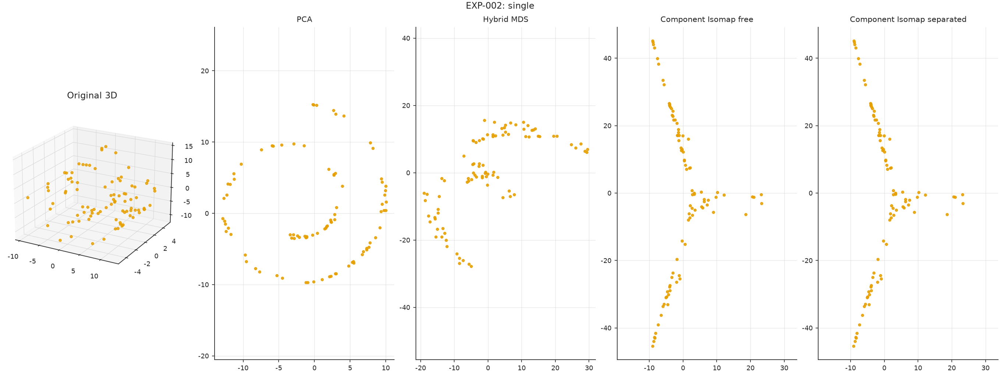

EXP-002 · Versioned figure

---

<!-- _class: figure -->
# Hybrid MDS: two Swiss rolls

EXP-002 · Versioned figure

---

<!-- _class: figure -->
# Wide radius-grid stress

EXP-003 · Versioned figure

---

<!-- _class: figure -->
# Radius transfer across densities

EXP-004 · Versioned figure

---

<!-- _class: figure -->
# Two Swiss rolls

EXP-005 · Versioned figure

---

<!-- _class: figure -->
# Two S-curves

EXP-005 · Versioned figure

---

<!-- _class: figure -->
# Parallel Swiss rolls

EXP-006 · Versioned figure

---

<!-- _class: figure -->
# Rotated Swiss rolls

EXP-006 · Versioned figure

---

<!-- _class: figure -->
# Separated and free alignment

EXP-007 · Versioned figure

---

<!-- _class: figure -->
# 1 Swiss roll

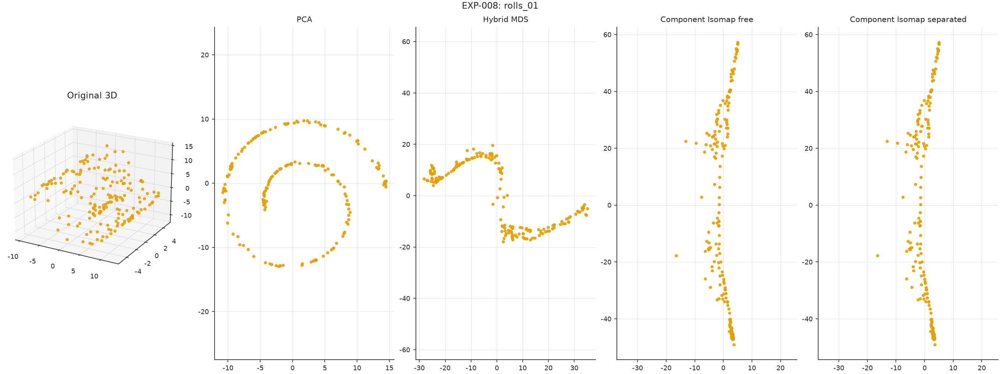

EXP-008 · Versioned figure

---

<!-- _class: figure -->
# 2 Swiss rolls

EXP-008 · Versioned figure

---

<!-- _class: figure -->
# 3 Swiss rolls

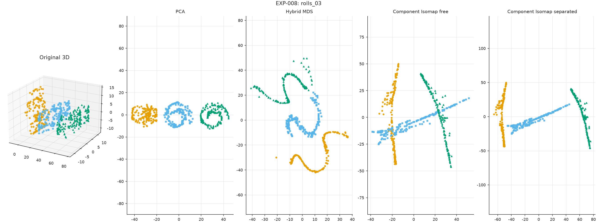

EXP-008 · Versioned figure

---

<!-- _class: figure -->
# 4 Swiss rolls

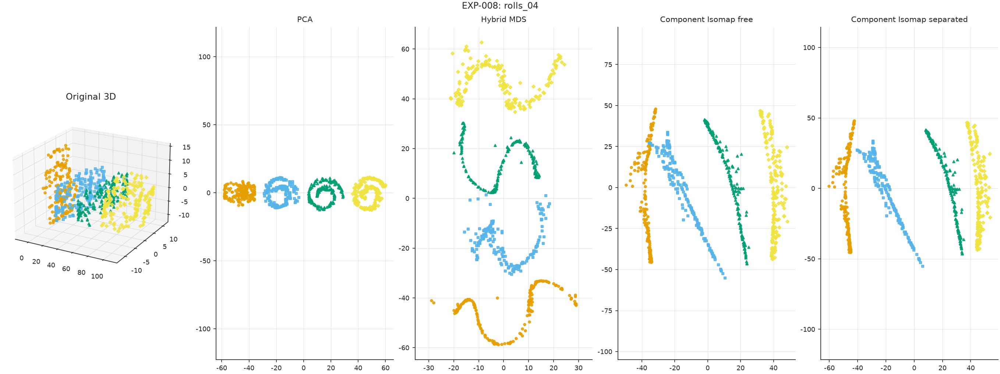

EXP-008 · Versioned figure

---

<!-- _class: figure -->
# 5 Swiss rolls

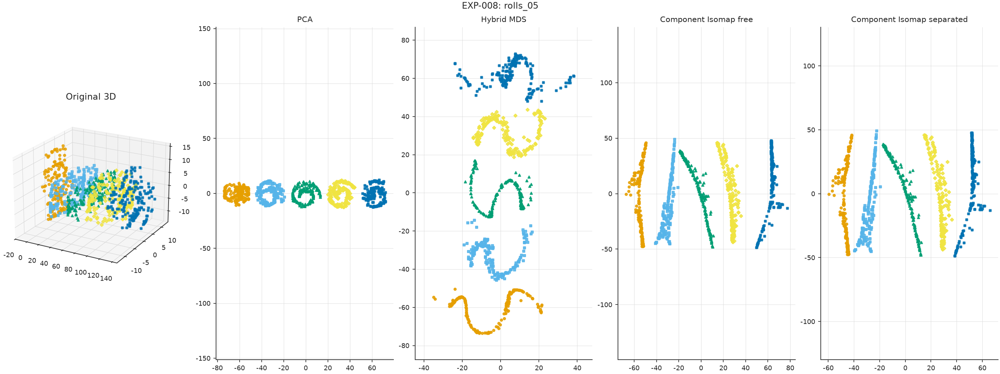

EXP-008 · Versioned figure

---

<!-- _class: figure -->
# 6 Swiss rolls

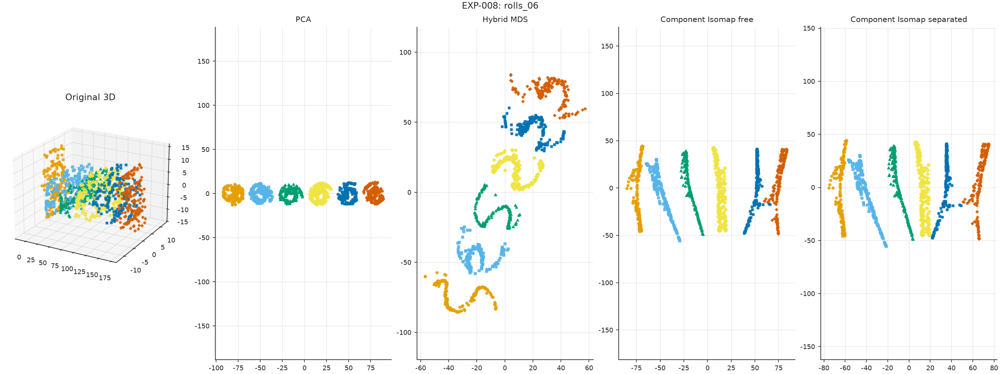

EXP-008 · Versioned figure

---

<!-- _class: figure -->
# Intrinsic stress against manifold count

EXP-008 · Versioned figure

---

<!-- _class: figure -->
# 3D and 2D geometry, published run

EXP-009 · Versioned figure

---

<!-- _class: figure -->
# H1 barcodes, published run

EXP-009 · Versioned figure

---

<!-- _class: figure -->
# 3D and 2D geometry, earlier rerun

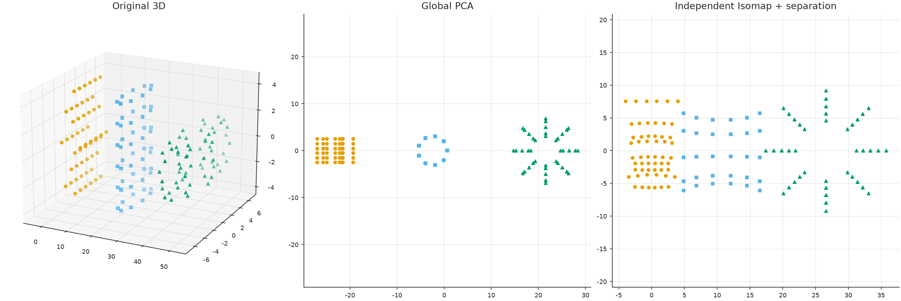

EXP-009 · Versioned figure

---

<!-- _class: figure -->
# H1 barcodes, earlier rerun

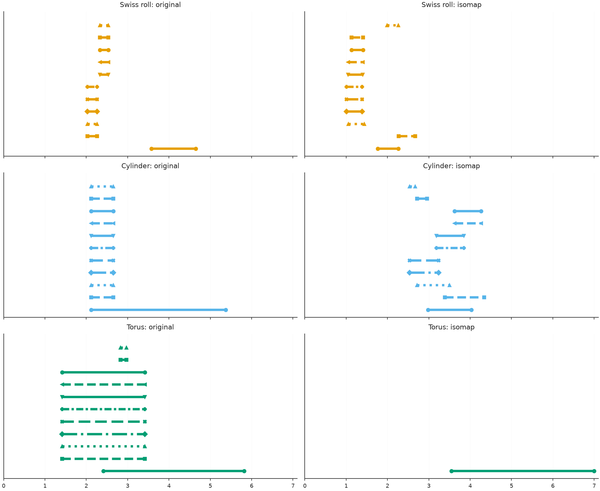

EXP-009 · Versioned figure

---

# Historical summary gallery

The next nine SVG panels remain clearly labeled as historical material.

Do not combine their rounded findings with reconstructed full-run CSV results without an implementation-parity audit.

---

<!-- _class: figure -->
# Historical summary EXP-001

Historical summary, not a new full-run figure

---

<!-- _class: figure -->
# Historical summary EXP-002

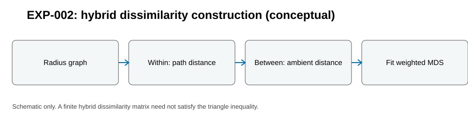

Historical summary, not a new full-run figure

---

<!-- _class: figure -->
# Historical summary EXP-003

Historical summary, not a new full-run figure

---

<!-- _class: figure -->
# Historical summary EXP-004

Historical summary, not a new full-run figure

---

<!-- _class: figure -->
# Historical summary EXP-005

Historical summary, not a new full-run figure

---

<!-- _class: figure -->
# Historical summary EXP-006

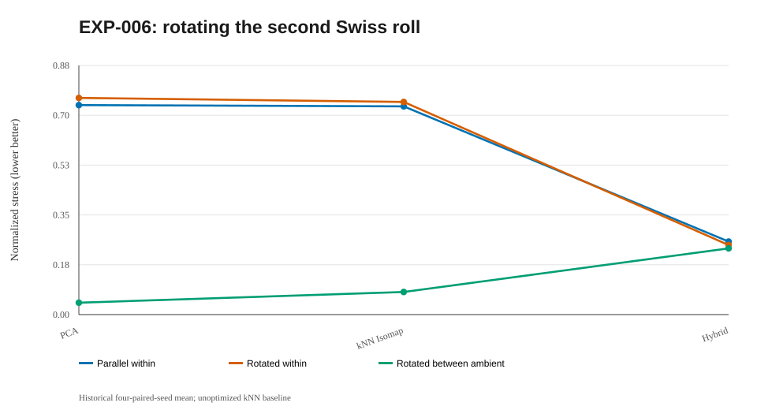

Historical summary, not a new full-run figure

---

<!-- _class: figure -->
# Historical summary EXP-007

Historical summary, not a new full-run figure

---

<!-- _class: figure -->
# Historical summary EXP-008

Historical summary, not a new full-run figure

---

<!-- _class: figure -->
# Historical summary EXP-009

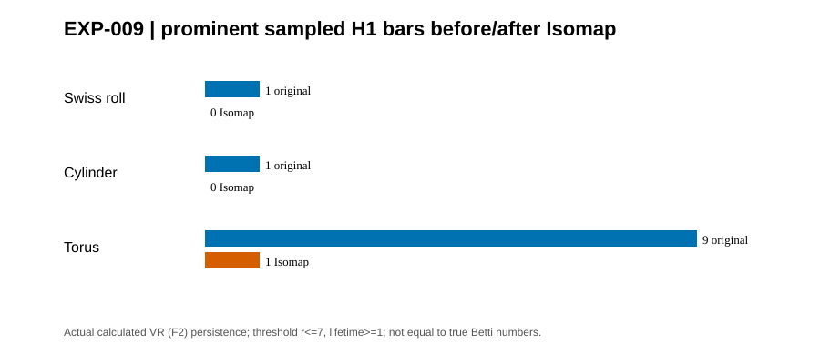

Historical summary, not a new full-run figure

---

<!-- _class: cover -->
# Discussion

Can independently unfolded manifolds be placed in a common low-dimensional space while **guaranteeing spatial separation** and minimizing distortion of their relative metric geometry?

$$
\boxed{Y_k=Z_kQ_k+t_k,\quad
{\rm dist}({\rm conv}Y_k,{\rm conv}Y_\ell)\ge\mu.}
$$

**Mathematical target:** characterize and compute the separation–distortion frontier $V(\mu)$.
